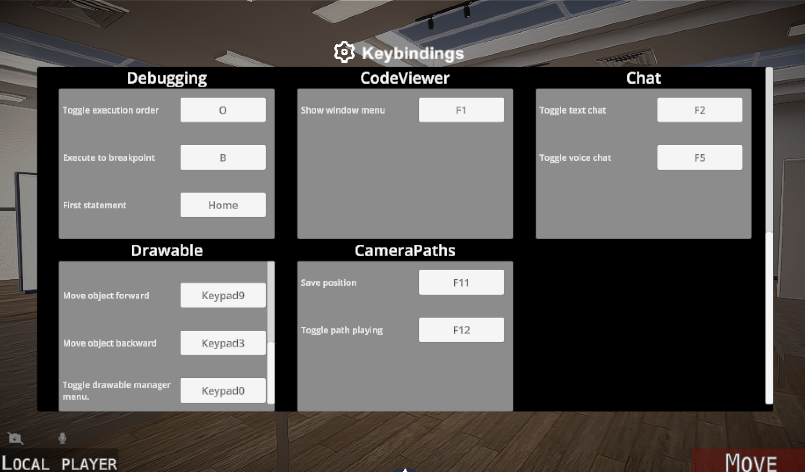
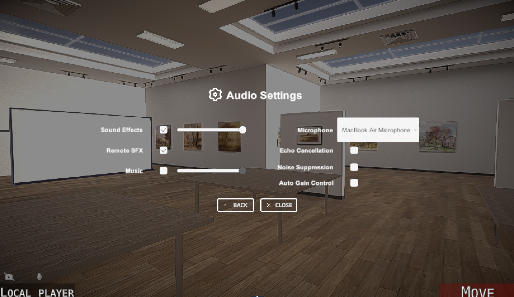
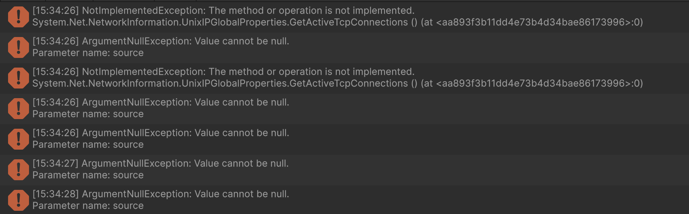
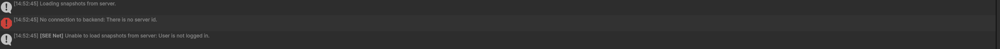
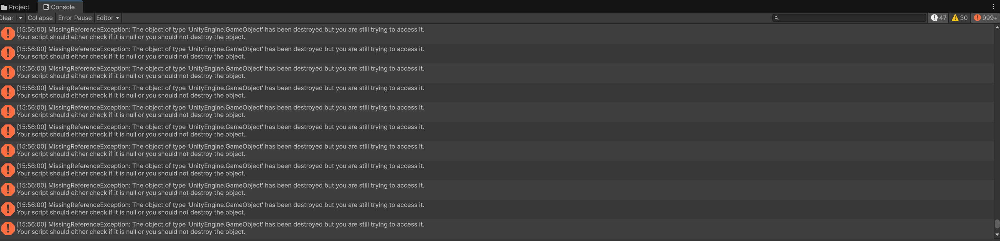

# UI Test Protocol - Modern UI Pack Upgrade ([#701](https://github.com/uni-bremen-agst/SEE/issues/701))

## Purpose and Scope

This protocol documents the manual UI tests for the migration
from Modern UI Pack 4 to Modern UI Pack 5 in SEE ([#701](https://github.com/uni-bremen-agst/SEE/issues/701)).

The tests check the appearance and behavior of affected UI elements,
including menus, dropdowns, selectors, dialogs, and notifications.
This snapshot documents 53 test cases. Shared controls with the same access
path are grouped in one test case. Vendor demo UIs
are outside the scope of this protocol.

Automated test results are documented separately. Existing issues
unrelated to the migration are recorded as observations. A failed manual
test is not automatically classified as a migration regression; compare
the previous version when the cause is unclear.

**Execution state:** Snapshot updated on 09.11.2026. The 53 documented
cases include 52 Passed and 1 Blocked. See Test Run Summary for the remaining
prerequisite.

## Test Environment

- **Branch:** 701-upgrade-modern-ui-pack-to-5.5.29
- **Commit:** 19fc3a3694ed41c28e19930eebbec13ded2a909c
- **Unity version:** 6000.0.67f1
- **MUIP version:** 5.5.27
- **Platforms:**
  - Noah Thiering: macOS 27.2
  - Tristan Mundt: Windows 11
- **Mode:** Unity Editor
- **Input:** Mouse and keyboard

Each test case records the tester and platform used.
Deviations from this environment must be documented in the test case,
including a different commit, scene, keybinding, or required test harness.

## Preparation and Menu Access

1. Verify the actual branch and commit with `git branch --show-current`
   and `git rev-parse HEAD`. Use the migration branch to test this migration.
2. Open [SEEStart.unity](https://github.com/uni-bremen-agst/SEE/blob/19fc3a3694ed41c28e19930eebbec13ded2a909c/Assets/Scenes/SEEStart.unity) and enter Play Mode.
3. For pre-Host tests, stay in the Configuration start menu. For other
   cases, choose Desktop input, start Host, and wait for the local player.
4. For graph views, wait for the required city and graph to load. For
   drawing tests, prepare a whiteboard or a disposable Sticky Note.
5. Focus the Game view. Close unrelated menus and unfocus text inputs
   before using shortcuts. Record custom bindings as deviations.

The access paths below use the default bindings from
[KeyBindings.cs](https://github.com/uni-bremen-agst/SEE/blob/19fc3a3694ed41c28e19930eebbec13ded2a909c/Assets/SEE/Controls/KeyActions/KeyBindings.cs)
and the menu names from
[ActionStateTypes.cs](https://github.com/uni-bremen-agst/SEE/blob/19fc3a3694ed41c28e19930eebbec13ded2a909c/Assets/SEE/Controls/ReversibleActions/ActionStateTypes.cs).

| Default key | UI entry |
| --- | --- |
| Space | Mode Selection; then Drawable, Metric Board, or Table. |
| K | RuntimeConfigMenu. |
| Tab | Tree View. |
| Numpad 0 | Drawable Manager. |
| H | Help System. |
| F6 | Hand Animations menu. |
| F7 | Snapshots window. |
| Pause/Break | In-game Settings; Keybindings lists the actual assignments. |

Startup **Settings** and in-game **Settings** are different UIs.
The literal runtime field path is **Nodes → NodeLayoutSettings → Kind**;
NodeLayoutSettings is not displayed as separate words in this code.
K opens RuntimeConfigMenu, not the legacy ConfigMenu prefab.
If a shortcut is unavailable on the keyboard or intercepted by the OS,
use its configured binding and document the deviation.

The nine legacy/base prefabs in the final three cases have no verified
normal Desktop menu entry. Their cases explicitly require an isolated
initialized harness. Without that setup, record Blocked and the reason;
do not invent a menu path or treat an uninitialized prefab as a passed test.

## Test Status and Recording

Allowed status values: **Not tested / Passed / Failed / Blocked**.

- **Not tested:** No manual execution has been recorded.
- **Passed:** All applicable steps meet their expected results.
- **Failed:** A reproducible deviation exists; record the exact action and result.
- **Blocked:** Missing prerequisites prevent a valid test; record the blocker.

Check readability, icons, hover/pressed/disabled states, one action per
click, normal scrolling speed, closing, and reopening. Unexpected new UI
exceptions are failures to investigate. Expected validation feedback and
missing external test data must be distinguished from migration defects.
Use a separate filled copy for each tester/platform or comparison run.

## Test Case Index

| Test case | Objective / UI | Status       |
| --- | --- | --- |
| [TC-01](#tc-01) | Runtime ConfigMenu dropdown selection | ✅ Passed |
| [TC-02](#tc-02) | Main menus, lists, and nested navigation | ✅ Passed |
| [TC-03](#tc-03) | Property dialog validation, confirmation, and cancellation | ✅ Passed |
| [TC-04](#tc-04) | Property-dialog file and directory input | ✅ Passed |
| [TC-05](#tc-05) | In-game Settings navigation | ✅ Passed |
| [TC-06](#tc-06) | Keybinding confirmation dialog | ✅ Passed |
| [TC-07](#tc-07) | Notification appearance and dismissal | ✅ Passed |
| [TC-08](#tc-08) | Help entry controls and close icon | ✅ Passed |
| [TC-09](#tc-09) | Hand-animation calibration instructions | ✅ Passed |
| [TC-10](#tc-10) | Shared window frame behavior | ✅ Passed |
| [TC-11](#tc-11) | Tree View navigation, search, and scrolling | ✅ Passed |
| [TC-12](#tc-12) | Property Window display and controls | ✅ Passed |
| [TC-13](#tc-13) | Context-menu entries and submenus | ✅ Passed |
| [TC-14](#tc-14) | Snapshots window and populated entries | 🚧 Blocked |
| [TC-15](#tc-15) | Debug action bar | ✅ Passed |
| [TC-16](#tc-16) | SEE debug console | ✅ Passed |
| [TC-17](#tc-17) | Runtime ConfigMenu tabs and settings containers | ✅ Passed |
| [TC-18](#tc-18) | Runtime boolean setting switch | ✅ Passed |
| [TC-19](#tc-19) | Runtime data-path picker | ✅ Passed |
| [TC-20](#tc-20) | Runtime configuration action buttons | ✅ Passed |
| [TC-21](#tc-21) | Runtime collection add/remove buttons | ✅ Passed |
| [TC-22](#tc-22) | Small runtime setting editor | ✅ Passed |
| [TC-23](#tc-23) | Metrics board and city dropdown | ✅ Passed |
| [TC-24](#tc-24) | Metrics board placement rotation | ✅ Passed |
| [TC-25](#tc-25) | Save board button and dialog | ✅ Passed |
| [TC-26](#tc-26) | Load board button and dialog | ✅ Passed |
| [TC-27](#tc-27) | Drawable action bar and visibility toggle | ✅ Passed |
| [TC-28](#tc-28) | Line settings and selector arrows | ✅ Passed |
| [TC-29](#tc-29) | Shape settings and Shape/Config switch | ✅ Passed |
| [TC-30](#tc-30) | Text creation, style, and colors | ✅ Passed |
| [TC-31](#tc-31) | Image source selection | ✅ Passed |
| [TC-32](#tc-32) | Mind map creation menu | ✅ Passed |
| [TC-33](#tc-33) | Mind map parent selector | ✅ Passed |
| [TC-34](#tc-34) | Mind map node editing menu | ✅ Passed |
| [TC-35](#tc-35) | Mind map node-kind selector | ✅ Passed |
| [TC-36](#tc-36) | Line color-choice menu | ✅ Passed  |
| [TC-37](#tc-37) | Mind map color-choice menu | ✅ Passed |
| [TC-38](#tc-38) | Drawable Move/Rotate controls | ✅ Passed |
| [TC-39](#tc-39) | Drawable and Sticky Note scale menu | ✅ Passed |
| [TC-40](#tc-40) | Drawable cut/copy/paste menu | ✅ Passed |
| [TC-41](#tc-41) | Drawable save options | ✅ Passed |
| [TC-42](#tc-42) | Drawable load options | ✅ Passed |
| [TC-43](#tc-43) | Sticky Note operation selection | ✅ Passed |
| [TC-44](#tc-44) | Sticky Note fine movement | ✅ Passed |
| [TC-45](#tc-45) | Sticky Note edit controls | ✅ Passed |
| [TC-46](#tc-46) | Sticky Note X rotation | ✅ Passed |
| [TC-47](#tc-47) | Sticky Note Y rotation | ✅ Passed |
| [TC-48](#tc-48) | Drawable Manager search and controls | ✅ Passed |
| [TC-49](#tc-49) | Drawable Manager rows with and without descriptions | ✅ Passed |
| [TC-50](#tc-50) | Surface color menu | ✅ Passed |
| [TC-51](#tc-51) | Table modification menu | ✅ Passed |
| [TC-52](#tc-52) | Table scaling controls | ✅ Passed |
| [TC-53](#tc-53) | Generic TabMenu base templates | ✅ Passed |

## TC-01 – Runtime ConfigMenu dropdown selection

- **Tester:** Tristan Mundt
- **Date:** 05.11.2026
- **Platform:** Windows 11
- **Environment deviations:** None
- **Status:** Passed

<!-- Allowed values: Not tested / Passed / Failed / Blocked -->

**Objective:** Verify that a dropdown opens on one pointer click, changes its setting, and displays the current selection after reopening.

**Preconditions:**

- SEE is running as a Desktop Host with a code city.
- All other menus and text inputs are closed.
- Exact target: K → Nodes → NodeLayoutSettings → Kind. This is RuntimeConfigMenu, not the legacy ConfigMenu prefab.

**Affected prefabs:** [UI/Input Group - Dropdown 2.prefab](https://github.com/uni-bremen-agst/SEE/blob/19fc3a3694ed41c28e19930eebbec13ded2a909c/Assets/Resources/Prefabs/UI/Input%20Group%20-%20Dropdown%202.prefab).

| Step | Action | Expected result |
| --- | --- | --- |
| 1 | Press K, select the target city if needed, click Nodes, and expand NodeLayoutSettings. | The Kind dropdown is visible. Labels use the literal field name NodeLayoutSettings. |
| 2 | Click the Kind dropdown once. | The list opens and remains open; entries are readable and correctly positioned. |
| 3 | Move the pointer over a different entry. | The entry is highlighted without overlapping text or icons. |
| 4 | Select that entry. | The list closes and the selected value is displayed. |
| 5 | Check the associated NodeLayoutSettings.Kind value; redraw if needed to inspect its effect. | The setting reflects the selected value. The resulting layout is only evaluated when a redraw occurs. |
| 6 | Open the dropdown again. | The current selection is displayed correctly; opening does not immediately close the list. |
| 7 | Close and reopen the menu with K, then return to Nodes → NodeLayoutSettings → Kind. | The dropdown displays the current setting correctly. Restore the original value after the test. |

**Actual result:**

Everything works as intended.

**Evidence / defects:**

No defects observed. No screenshots recorded.

## TC-02 – Main menus, lists, and nested navigation

- **Tester:** Noah Thiering
- **Date:** 06.11.2026
- **Platform:** macOS 27.2
- **Environment deviations:** None
- **Status:** Passed

<!-- Allowed values: Not tested / Passed / Failed / Blocked -->

**Objective:** Verify shared menu, list, and entry-button behavior.

**Preconditions:**

- Open SEEStart.unity and start Play Mode.
- Use Desktop input.

**Affected prefabs:** [UI/Menu.prefab](https://github.com/uni-bremen-agst/SEE/blob/19fc3a3694ed41c28e19930eebbec13ded2a909c/Assets/Resources/Prefabs/UI/Menu.prefab), [UI/NestedMenu.prefab](https://github.com/uni-bremen-agst/SEE/blob/19fc3a3694ed41c28e19930eebbec13ded2a909c/Assets/Resources/Prefabs/UI/NestedMenu.prefab), [UI/MenuEntries.prefab](https://github.com/uni-bremen-agst/SEE/blob/19fc3a3694ed41c28e19930eebbec13ded2a909c/Assets/Resources/Prefabs/UI/MenuEntries.prefab), [UI/Button.prefab](https://github.com/uni-bremen-agst/SEE/blob/19fc3a3694ed41c28e19930eebbec13ded2a909c/Assets/Resources/Prefabs/UI/Button.prefab).

| Step | Action | Expected result |
| --- | --- | --- |
| 1 | Inspect the Configuration start menu before starting Host. | Host, Client, Toggle Desktop/VR, Telemetry Mode, and Settings entries are readable. |
| 2 | Start Host, wait for the player, and press Space. | Mode Selection opens. |
| 3 | Open Drawable, return to the parent menu, then open Metric Board. | The corresponding nested entries appear and back navigation works. |
| 4 | Scroll a long list and use its search field. | The list moves at a usable speed and search changes the displayed entries. |
| 5 | Hover over and select one entry, then reopen the menu. | Hover feedback is visible; one selection activates one action, and the menu remains usable. |

**Actual result:** All test steps produced the expected results. No deviations were observed.

**Evidence / defects:** No defects observed. No screenshots recorded.

## TC-03 – Property dialog validation, confirmation, and cancellation

- **Tester:** Tristan Mundt
- **Date:** 05.11.2026
- **Platform:** Windows 11
- **Environment deviations:** None
- **Status:** Passed

<!-- Allowed values: Not tested / Passed / Failed / Blocked -->

**Objective:** Verify property-dialog lifecycle and string input without accepting invalid settings.

**Preconditions:**

- Start Play Mode in SEEStart.unity.
- Keep the Configuration start menu open; do not start Host yet.
- Record the current User name, Server IPv4 Address, and Server UDP Port before changing them.

**Affected prefabs:** [UI/PropertyDialog.prefab](https://github.com/uni-bremen-agst/SEE/blob/19fc3a3694ed41c28e19930eebbec13ded2a909c/Assets/Resources/Prefabs/UI/PropertyDialog.prefab), [UI/InputFields/StringInputField.prefab](https://github.com/uni-bremen-agst/SEE/blob/19fc3a3694ed41c28e19930eebbec13ded2a909c/Assets/Resources/Prefabs/UI/InputFields/StringInputField.prefab).

| Step | Action | Expected result |
| --- | --- | --- |
| 1 | Click Settings in the Configuration start menu. | The User settings property dialog opens. |
| 2 | Change User name to a temporary value and cancel using the dialog cancel control. | The dialog closes without confirming the new value. |
| 3 | Click Settings again. | The current saved user name is displayed; the cancelled change was not committed. |
| 4 | Enter an invalid Server IPv4 Address, such as 999.1.1.1, and confirm. | A validation error is reported and successful completion is prevented. |
| 5 | Restore the valid IP; enter an invalid Server UDP Port and confirm. | The invalid port is rejected with the intended feedback. |
| 6 | Restore valid settings, change User name, and confirm. | The dialog closes successfully and applies the confirmed user name once. |
| 7 | Reopen Settings, verify the value, and restore the original settings. | The dialog reopens correctly and displays the confirmed values. |

**Actual result:**

Everything works as intended.

**Evidence / defects:**

No defects observed. No screenshots recorded.

## TC-04 – Property-dialog file and directory input

- **Tester:** Tristan Mundt
- **Date:** 05.11.2026
- **Platform:** Windows 11
- **Environment deviations:** None
- **Status:** Passed

<!-- Allowed values: Not tested / Passed / Failed / Blocked -->

**Objective:** Verify text entry and browser behavior for file-path properties.

**Preconditions:**

- SEE is running as Desktop Host with a loaded code city.
- A graph node with a source-file reference and accessible code is available; namespace-only nodes are not sufficient.
- Prepare an existing test directory and file; no debug session is required.

**Affected prefabs:** [UI/InputFields/FilePathInputField.prefab](https://github.com/uni-bremen-agst/SEE/blob/19fc3a3694ed41c28e19930eebbec13ded2a909c/Assets/Resources/Prefabs/UI/InputFields/FilePathInputField.prefab).

| Step | Action | Expected result |
| --- | --- | --- |
| 1 | Press Tab, expand the tree to a node with a source file, then right-click that node → Inspect → Show Code. | A Code Window opens. Show Code is only offered when the graph element has a source-file reference. |
| 2 | In the Code Window header, click the bug icon with tooltip Debug Adapter. | The Debug Adapter dialog opens. These header buttons are intentionally hidden in Tree View. |
| 3 | Locate Working Directory and File Name. | Both labelled path properties and their browser buttons are visible. |
| 4 | Open the browser next to Working Directory and choose the test directory. | The directory path appears in Working Directory. |
| 5 | Open the browser next to File Name, then cancel it. | The previous file path remains unchanged by browser cancellation. |
| 6 | Type a file path and reopen its browser. | Text entry works and the browser remains usable. |
| 7 | Cancel the Debug Adapter dialog and open it again through the same header button. | The property controls initialise correctly again; no new UI exception occurs. |

**Actual result:**

Everything works as intended.

**Evidence / defects:**

No defects observed. No screenshots recorded.

## TC-05 – In-game Settings navigation

- **Tester:** Noah Thiering
- **Date:** 05.11.2026
- **Platform:** macOS 27.2
- **Environment deviations:** None
- **Status:** Passed

<!-- Allowed values: Not tested / Passed / Failed / Blocked -->

**Objective:** Verify the in-game settings menu and its tabs, lists, and controls.

**Preconditions:**

- SEE is running as Desktop Host.
- The Pause/Break binding is available; if rebound, record the actual key as an environment deviation.

**Affected prefabs:** [UI/SettingsMenu.prefab](https://github.com/uni-bremen-agst/SEE/blob/19fc3a3694ed41c28e19930eebbec13ded2a909c/Assets/Resources/Prefabs/UI/SettingsMenu.prefab).

| Step | Action | Expected result |
| --- | --- | --- |
| 1 | Press Pause/Break in the Game view. | The in-game Settings menu opens; this is separate from Settings in the start menu. |
| 2 | Open the available settings sections and return with their BACK controls. | Each section opens, shows readable controls, and returns correctly. |
| 3 | Open Keybindings and scroll its list. | Keybinding groups and keys are readable and scroll at a usable speed. |
| 4 | Change a reversible setting and observe its displayed value. | The control responds and displays the selected value. |
| 5 | Close and reopen Settings, verify the value, then restore the original setting. | The menu remains usable after reopening. |

**Actual result:** All remaining test steps produced the expected results. The BACK button in Keybindings was not visible. This issue was also present before the upgrade to MUIP 5.

**Evidence / defects:** Existing issue: BACK button not visible in Keybindings. Reproduced in the previous version; not introduced by the MUIP upgrade. Returning via the button could not be verified.

No back button visible at the bottom:

Visible and working back button in Audio Settings:

## TC-06 – Keybinding confirmation dialog

- **Tester:** Noah Thiering
- **Date:** 05.11.2026
- **Platform:** macOS 27.2
- **Environment deviations:** None
- **Status:** Passed

<!-- Allowed values: Not tested / Passed / Failed / Blocked -->

**Objective:** Verify that confirmation and cancellation each trigger the intended single action.

**Preconditions:**

- SEE is running as Desktop Host.
- Record the original Help key binding and choose an unused assignable key for this test.

**Affected prefabs:** [UI/ConfirmDialog.prefab](https://github.com/uni-bremen-agst/SEE/blob/19fc3a3694ed41c28e19930eebbec13ded2a909c/Assets/Resources/Prefabs/UI/ConfirmDialog.prefab).

| Step | Action | Expected result |
| --- | --- | --- |
| 1 | Press Pause/Break → Keybindings → find Help in General. | The Help action and its current key are visible. |
| 2 | Click its key button and press the unused test key. | The Change Key? confirmation dialog opens. |
| 3 | Choose the cancellation response. | The dialog closes and the previous Help binding remains unchanged. |
| 4 | Repeat the same steps and choose the confirmation response. | The chosen binding changes once and the dialog closes. |
| 5 | Use the new key to open Help, then restore the original binding through Settings. | The new binding works and restoration is possible through the same dialog. |

**Actual result:** All test steps produced the expected results. No deviations were observed.

**Evidence / defects:** No defects observed. No screenshots recorded.

## TC-07 – Notification appearance and dismissal

- **Tester:** Noah Thiering
- **Date:** 06.11.2026
- **Platform:** macOS 27.2
- **Environment deviations:** None
- **Status:** Passed

<!-- Allowed values: Not tested / Passed / Failed / Blocked -->

**Objective:** Verify notification text, icon, animation, and dismissal.

**Preconditions:**

- Open SEEStart.unity in Play Mode with its Configuration start menu visible.

**Affected prefabs:** [UI/Notification.prefab](https://github.com/uni-bremen-agst/SEE/blob/19fc3a3694ed41c28e19930eebbec13ded2a909c/Assets/Resources/Prefabs/UI/Notification.prefab).

| Step | Action | Expected result |
| --- | --- | --- |
| 1 | Click Toggle Desktop/VR and inspect the Environment notification. | The notification appears with readable text and a visible icon. |
| 2 | Return the environment to Desktop before starting Host. | The Environment notification reflects the selected input environment. |
| 3 | Use a notification close control and observe an automatically expiring notification. | Both dismissal paths complete without leaving a blocking UI element. |
| 4 | Start Host and trigger an information message, for example Metric Board → Save Board with no boards, then click its Save button. | The expected information notification appears. |
| 5 | With no text input focused, press X. | Existing notifications are dismissed. |

**Actual result:** All test steps produced the expected results. No deviations were observed.

**Evidence / defects:** No defects observed. No screenshots recorded.

## TC-08 – Help entry controls and close icon

- **Tester:** Noah Thiering
- **Date:** 05.11.2026
- **Platform:** macOS 27.2
- **Environment deviations:** None
- **Status:** Passed

<!-- Allowed values: Not tested / Passed / Failed / Blocked -->

**Objective:** Verify the help-entry view, its controls, and the migrated Close sprite reference.

**Preconditions:**

- SEE is running as Desktop Host.
- The help configuration is present; video playback additionally requires its referenced video files.

**Affected prefabs:** [UI/HelpSystemEntry.prefab](https://github.com/uni-bremen-agst/SEE/blob/19fc3a3694ed41c28e19930eebbec13ded2a909c/Assets/Resources/Prefabs/UI/HelpSystemEntry.prefab).

| Step | Action | Expected result |
| --- | --- | --- |
| 1 | Press H → Navigation → Player navigation → Simple navigation. | The help-entry view opens. |
| 2 | Inspect the text, video area, and Close icon. | The layout is readable and the Close icon is visible. |
| 3 | Use the available playback and navigation controls. | Controls react appropriately; record missing video files as a prerequisite problem. |
| 4 | Click Close. | The entry view closes. |
| 5 | Repeat H → Navigation → Player navigation → Simple navigation. | The entry reopens and remains usable. |

**Actual result:** All test steps produced the expected results. No deviations were observed.

**Evidence / defects:** No defects observed. No screenshots recorded.

## TC-09 – Hand-animation calibration instructions

- **Tester:** Noah Thiering
- **Date:** 05.11.2026
- **Platform:** macOS 27.2
- **Environment deviations:** None
- **Status:** Passed

<!-- Allowed values: Not tested / Passed / Failed / Blocked -->

**Objective:** Verify that the calibration instructions can be opened and closed.

**Preconditions:**

- SEE is running as Desktop Host.
- This case checks the instruction UI; camera tracking is not required.

**Affected prefabs:** [UI/InstructionsForHandAnimations.prefab](https://github.com/uni-bremen-agst/SEE/blob/19fc3a3694ed41c28e19930eebbec13ded2a909c/Assets/Resources/Prefabs/UI/InstructionsForHandAnimations.prefab).

| Step | Action | Expected result |
| --- | --- | --- |
| 1 | Press F6 → Hand Animations → Instructions for calibration. | The calibration instructions open. |
| 2 | Inspect all instruction text and controls. | Content is readable and no controls overlap. |
| 3 | Click Close. | The instruction panel closes. |
| 4 | Repeat F6 → Hand Animations → Instructions for calibration. | The instructions open again without duplicate panels or listeners. |

**Actual result:** All test steps produced the expected results. No deviations were observed.

**Evidence / defects:** No defects observed. No screenshots recorded.

## TC-10 – Shared window frame behavior

- **Tester:** Noah Thiering
- **Date:** 06.11.2026
- **Platform:** macOS 27.2
- **Environment deviations:** None
- **Status:** Passed
-
<!-- Allowed values: Not tested / Passed / Failed / Blocked -->

**Objective:** Verify dragging, resizing, closing, and switching windows.

**Preconditions:**

- SEE is running as Desktop Host with a loaded code city.

**Affected prefabs:** [UI/BaseWindow.prefab](https://github.com/uni-bremen-agst/SEE/blob/19fc3a3694ed41c28e19930eebbec13ded2a909c/Assets/Resources/Prefabs/UI/BaseWindow.prefab).

| Step | Action | Expected result |
| --- | --- | --- |
| 1 | Press Tab to open Tree View, then numpad 0 to open Drawable Manager. | Both window types are available in the local window space. |
| 2 | Drag a window by its header. | The window follows the pointer and remains within a usable layout. |
| 3 | Resize the window using its available resize control. | Contents adapt without losing accessible controls. |
| 4 | Switch between open window tabs. | The corresponding content becomes active. |
| 5 | Close Tree View and reopen it with Tab. | The window can be opened again and its header controls still work. |

**Actual result:** All test steps produced the expected results. No deviations were observed.

**Evidence / defects:** No defects observed. No screenshots recorded.

## TC-11 – Tree View navigation, search, and scrolling

- **Tester:** Noah Thiering
- **Date:** 05.11.2026
- **Platform:** macOS 27.2
- **Environment deviations:** None
- **Status:** Passed

<!-- Allowed values: Not tested / Passed / Failed / Blocked -->

**Objective:** Verify that a loaded graph remains navigable through the tree UI.

**Preconditions:**

- SEE is running as Desktop Host with a loaded graph containing several nodes.

**Affected prefabs:** [UI/TreeView.prefab](https://github.com/uni-bremen-agst/SEE/blob/19fc3a3694ed41c28e19930eebbec13ded2a909c/Assets/Resources/Prefabs/UI/TreeView.prefab).

| Step | Action | Expected result |
| --- | --- | --- |
| 1 | Press Tab. | Tree View opens for the loaded city. |
| 2 | Expand and collapse a node with children. | Only the relevant child list changes visibility. |
| 3 | Enter a known node name in the search field. | Matching entries are shown and the search text remains readable. |
| 4 | Clear search and scroll the tree. | All applicable entries return and scrolling has a usable speed. |
| 5 | Select an entry and open its context menu with a right click. | Selection and context-menu controls are available. |
| 6 | Close and reopen Tree View with Tab. | The view remains functional. |

**Actual result:** All test steps produced the expected results. No deviations were observed.

**Evidence / defects:** No defects observed. No screenshots recorded.

## TC-12 – Property Window display and controls

- **Tester:** Noah Thiering
- **Date:** 05.11.2026
- **Platform:** macOS 27.2
- **Environment deviations:** None
- **Status:** Passed

<!-- Allowed values: Not tested / Passed / Failed / Blocked -->

**Objective:** Verify property display, filtering, and switching inspected objects.

**Preconditions:**

- SEE is running as Desktop Host with at least two graph nodes.

**Affected prefabs:** [UI/PropertyWindow.prefab](https://github.com/uni-bremen-agst/SEE/blob/19fc3a3694ed41c28e19930eebbec13ded2a909c/Assets/Resources/Prefabs/UI/PropertyWindow.prefab).

| Step | Action | Expected result |
| --- | --- | --- |
| 1 | Press Tab → right-click a tree node → Inspect → Properties. | The Property Window opens for that node. |
| 2 | Expand and collapse property groups. | Group contents toggle without broken layout. |
| 3 | Use the search, filter, and sort controls offered by the view. | The property list updates according to the selected options. |
| 4 | Scroll the property list. | Entries remain readable and scrolling is usable. |
| 5 | Open Inspect → Properties for a different node. | The corresponding properties are displayed for the new target. |
| 6 | Close and reopen the Property Window through the same context-menu path. | The view and its controls initialise correctly again. |

**Actual result:** All Property Window test steps produced the expected
results. The macOS retest on 09.11.2026 completed without errors. During
the original macOS run, opening the window triggered a
`NotImplementedException`, followed by repeated `ArgumentNullException`
errors. These did not prevent completion of the test steps.

**Evidence / defects:** The `GetActiveTcpConnections()` exception was also
reproduced on `master` before the MUIP 5 upgrade. Commit
[27ea1219ff](https://github.com/uni-bremen-agst/SEE/commit/27ea1219fffcae8727dd105024112589b26add05)
fixes the JavaScript debug adapter's port selection on macOS by avoiding
that unsupported API. Neither exception recurred in the macOS retest.
Tristan reported no corresponding errors on Windows.

## TC-13 – Context-menu entries and submenus

- **Tester:** Noah Thiering
- **Date:** 05.11.2026
- **Platform:** macOS 27.2
- **Environment deviations:** None
- **Status:** Passed

<!-- Allowed values: Not tested / Passed / Failed / Blocked -->

**Objective:** Verify pointer navigation, entry activation, and outside-click dismissal.

**Preconditions:**

- SEE is running as Desktop Host with a loaded graph.

**Affected prefabs:** [UI/PopupMenuButton.prefab](https://github.com/uni-bremen-agst/SEE/blob/19fc3a3694ed41c28e19930eebbec13ded2a909c/Assets/Resources/Prefabs/UI/PopupMenuButton.prefab), [UI/PopupMenuSubMenuButton.prefab](https://github.com/uni-bremen-agst/SEE/blob/19fc3a3694ed41c28e19930eebbec13ded2a909c/Assets/Resources/Prefabs/UI/PopupMenuSubMenuButton.prefab).

| Step | Action | Expected result |
| --- | --- | --- |
| 1 | Press Tab and right-click a tree node. | Its context menu appears at a usable position. |
| 2 | Click Inspect to open its submenu. | The submenu opens and its entries are readable. |
| 3 | Move the pointer into the submenu and select Properties. | The submenu remains reachable and exactly one Properties action is performed. |
| 4 | Move the pointer outside the context menu and its submenu. | The context menu closes without selecting an entry. |
| 5 | Repeat with another node and inspect hover/disabled states. | States are consistent; disabled actions cannot be triggered. |

**Actual result:** All test steps produced the expected results. No deviations were observed.

**Evidence / defects:** No defects observed. No screenshots recorded.

## TC-14 – Snapshots window and populated entries

- **Tester:** Tristan
- **Date:** 07.11.2026
- **Platform:** Windows 11
- **Environment deviations:** None
- **Status:** Blocked

<!-- Allowed values: Not tested / Passed / Failed / Blocked -->

**Objective:** Verify snapshot listing, refresh, and entry controls with real server data.

**Preconditions:**

- SEE is running as Desktop Host.
- The snapshot backend is configured and at least one test snapshot exists. An empty server cannot validate the entry prefab.

**Affected prefabs:** [UI/Snapshots/SnapshotsWindow.prefab](https://github.com/uni-bremen-agst/SEE/blob/19fc3a3694ed41c28e19930eebbec13ded2a909c/Assets/Resources/Prefabs/UI/Snapshots/SnapshotsWindow.prefab), [UI/Snapshots/SnapshotWindowItem.prefab](https://github.com/uni-bremen-agst/SEE/blob/19fc3a3694ed41c28e19930eebbec13ded2a909c/Assets/Resources/Prefabs/UI/Snapshots/SnapshotWindowItem.prefab).

| Step | Action | Expected result |
| --- | --- | --- |
| 1 | Press F7. | The Snapshots window opens. |
| 2 | Click Refresh, identified by tooltip Reload snapshots from server. | The list updates from the backend without duplicating entries. |
| 3 | Scroll the populated list and hover over entry controls. | Snapshot labels and action controls are readable and reachable. |
| 4 | Use an available action on a disposable test snapshot; record its label in Actual result. | The selected action affects the intended snapshot once. |
| 5 | Close the window and press F7 again. | The window reopens and refresh remains usable. |

**Actual result:** F7 opened and reopened the window, and the Refresh button
responded. The backend request stopped because the session had no server ID.
Loading and refreshing a populated list, scrolling its entries, and downloading
a snapshot require a configured snapshot backend with a disposable test snapshot.

**Evidence / defects:**

## TC-15 – Debug action bar

- **Tester:** Noah Thiering
- **Date:** 09.11.2026
- **Platform:** macOS 27.2
- **Status:** Passed

<!-- Allowed values: Not tested / Passed / Failed / Blocked -->

**Objective:** Verify the debugging buttons during a configured debug session.

**Preconditions:**

- SEE is running as Desktop Host with a loaded city.
- A supported debug adapter and suitable test program are installed and configured.

**Affected prefabs:** [UI/DebugAdapterProtocolControls.prefab](https://github.com/uni-bremen-agst/SEE/blob/19fc3a3694ed41c28e19930eebbec13ded2a909c/Assets/Resources/Prefabs/UI/DebugAdapterProtocolControls.prefab).

| Step | Action | Expected result |
| --- | --- | --- |
| 1 | Press Tab → window-header Debug Adapter button; configure the adapter and city. | The configuration dialog opens and accepts the intended configuration. |
| 2 | Use the header Launch Configuration button, configure the test program, then click Run. | A debug session starts and its action bar appears. |
| 3 | Use Pause, Continue, Step Over, Step In, and Step Out when valid for the session. | Supported actions change execution once per click. |
| 4 | Use Console and Variables in the debug action bar. | The respective SEE windows open. |
| 5 | Inspect Reverse/StepBack/Restart visibility and use Stop. | Only supported optional actions are available; Stop ends the session without a stuck UI. |

**Actual result:** The tested debug action bar controls worked as expected.

**Evidence / defects:** The source window stayed on `Loading code window text...`
after a `NullReferenceException`. SEE then logged line-range errors when it
tried to highlight source lines after stepping. The source loading code and
the Pause handler, which returns early while the program is running, were
already present before the MUIP upgrade.

## TC-16 – SEE debug console

- **Tester:** Noah Thiering
- **Date:** 09.11.2026
- **Platform:** macOS 27.2
- **Environment deviations:** None
- **Status:** Passed

<!-- Allowed values: Not tested / Passed / Failed / Blocked -->

**Objective:** Verify output display, search, filtering, clearing, and interactive input.

**Preconditions:**

- A debug session is running, started through the configuration steps in the
  debug-action-bar case or through a local Play Mode fixture.
- The test program produces output and supports any expression used for input testing.

**Affected prefabs:** [UI/ConsoleWindow/ConsoleWindow.prefab](https://github.com/uni-bremen-agst/SEE/blob/19fc3a3694ed41c28e19930eebbec13ded2a909c/Assets/Resources/Prefabs/UI/ConsoleWindow/ConsoleWindow.prefab).

| Step | Action | Expected result |
| --- | --- | --- |
| 1 | Click Console in the debug action bar. | The SEE Console opens; this is not the Unity Editor Console. |
| 2 | Search for a known output fragment and change the available search options. | Displayed messages follow the search criteria. |
| 3 | Change channel/level filters, then scroll through output. | Filters apply correctly and remaining messages remain reachable. |
| 4 | Submit a supported test expression once. | The adapter processes one submission and displays the corresponding result. |
| 5 | Use Clear, close the window, then reopen it through Console in the action bar. | Clear affects the intended message list; the window can be reopened and used again. |

**Actual result:** All test steps produced the expected results. No deviations were observed.

**Evidence / defects:** No defects observed. No screenshots recorded.

## TC-17 – Runtime ConfigMenu tabs and settings containers

- **Tester:** Noah Thiering
- **Date:** 05.11.2026
- **Platform:** macOS 27.2
- **Environment deviations:** None
- **Status:** Passed

<!-- Allowed values: Not tested / Passed / Failed / Blocked -->

**Objective:** Verify runtime configuration navigation for the selected city.

**Preconditions:**

- SEE is running as Desktop Host with at least one loaded city.

**Affected prefabs:** [UI/RuntimeConfigMenu/RuntimeConfigMenu.prefab](https://github.com/uni-bremen-agst/SEE/blob/19fc3a3694ed41c28e19930eebbec13ded2a909c/Assets/Resources/Prefabs/UI/RuntimeConfigMenu/RuntimeConfigMenu.prefab), [UI/RuntimeConfigMenu/RuntimeTabButton.prefab](https://github.com/uni-bremen-agst/SEE/blob/19fc3a3694ed41c28e19930eebbec13ded2a909c/Assets/Resources/Prefabs/UI/RuntimeConfigMenu/RuntimeTabButton.prefab), [UI/RuntimeConfigMenu/RuntimeSettingsObject.prefab](https://github.com/uni-bremen-agst/SEE/blob/19fc3a3694ed41c28e19930eebbec13ded2a909c/Assets/Resources/Prefabs/UI/RuntimeConfigMenu/RuntimeSettingsObject.prefab).

| Step | Action | Expected result |
| --- | --- | --- |
| 1 | Press K. | RuntimeConfigMenu opens for a city. |
| 2 | Use the city selector if multiple cities are present. | The displayed configuration belongs to the selected city. |
| 3 | Click Nodes, then Edges, then Metric settings. | Each tab displays its associated settings. |
| 4 | Return to Nodes and expand NodeLayoutSettings. | Its nested settings appear without overlapping controls. |
| 5 | Scroll a long settings list, close the menu, and open it again. | Scrolling is usable and tabs/containers remain functional after reopening. |

**Actual result:** All test steps produced the expected results. No deviations were observed.

**Evidence / defects:** No defects observed. No screenshots recorded.

## TC-18 – Runtime boolean setting switch

- **Tester:** Noah Thiering
- **Date:** 05.11.2026
- **Platform:** macOS 27.2
- **Environment deviations:** None
- **Status:** Passed

<!-- Allowed values: Not tested / Passed / Failed / Blocked -->

**Objective:** Verify that a runtime switch updates its boolean setting once per click.

**Preconditions:**

- SEE is running as Desktop Host with a loaded city.
- Record the original ScaleOnlyLeafMetrics setting.

**Affected prefabs:** [UI/Input Group - Switch.prefab](https://github.com/uni-bremen-agst/SEE/blob/19fc3a3694ed41c28e19930eebbec13ded2a909c/Assets/Resources/Prefabs/UI/Input%20Group%20-%20Switch.prefab).

| Step | Action | Expected result |
| --- | --- | --- |
| 1 | Press K → Metric settings → locate ScaleOnlyLeafMetrics. | The labelled switch is visible. |
| 2 | Click the switch once. | The boolean setting changes once and the displayed state matches it. |
| 3 | Click it again. | The original state is restored without a second unintended toggle. |
| 4 | Close with K, reopen K → Metric settings, and inspect ScaleOnlyLeafMetrics. | The current setting is displayed correctly. |

**Actual result:** All test steps produced the expected results. No deviations were observed.

**Evidence / defects:** No defects observed. No screenshots recorded.

## TC-19 – Runtime data-path picker

- **Tester:** Tristan
- **Date:** 07.11.2026
- **Platform:** Windows 11
- **Environment deviations:** None
- **Status:** Passed

<!-- Allowed values: Not tested / Passed / Failed / Blocked -->

**Objective:** Verify the integrated root selection, path input, and file browser.

**Preconditions:**

- SEE is running as Desktop Host with a loaded city.
- Prepare a disposable layout test file and record the original layout kind and path.

**Affected prefabs:** [UI/Input Group - File Picker.prefab](https://github.com/uni-bremen-agst/SEE/blob/19fc3a3694ed41c28e19930eebbec13ded2a909c/Assets/Resources/Prefabs/UI/Input%20Group%20-%20File%20Picker.prefab).

| Step | Action | Expected result |
| --- | --- | --- |
| 1 | Press K → Nodes → expand NodeLayoutSettings → set Kind to FromFile. | The relevant LayoutPath controls are available. |
| 2 | Expand LayoutPath and inspect the path picker. | Root/path-type selection, path input, and browser control are visible. |
| 3 | Choose a suitable root type and select the test file with the browser. | The chosen root and path are displayed consistently. |
| 4 | Open the browser again and cancel. | The previous path is retained. |
| 5 | Edit the path text, reopen the picker, then restore the original kind/path. | Text entry and reopening work without a UI error. |

**Actual result:**

Everything works as intended.

**Evidence / defects:**

No defects observed. No screenshots recorded.

## TC-20 – Runtime configuration action buttons

- **Tester:** Noah Thiering
- **Date:** 05.11.2026
- **Platform:** macOS 27.2
- **Environment deviations:** None
- **Status:** Passed

<!-- Allowed values: Not tested / Passed / Failed / Blocked -->

**Objective:** Verify configuration-action labels, pointer feedback, and single execution.

**Preconditions:**

- SEE is running as Desktop Host with a loaded city.
- Use a test city whose redraw is safe; record any configured file paths before using file-related actions.

**Affected prefabs:** [UI/RuntimeConfigMenu/RuntimeConfigButton.prefab](https://github.com/uni-bremen-agst/SEE/blob/19fc3a3694ed41c28e19930eebbec13ded2a909c/Assets/Resources/Prefabs/UI/RuntimeConfigMenu/RuntimeConfigButton.prefab).

| Step | Action | Expected result |
| --- | --- | --- |
| 1 | Press K and inspect the configuration-action list on the right. | Available actions are labelled and reachable. |
| 2 | Hover over Draw Data in the right-side action list, then click it once. | Hover feedback appears and one drawing operation is requested. |
| 3 | Wait for completion and inspect enabled/disabled states. | The menu remains responsive; disabled actions cannot be triggered. |
| 4 | Close and reopen K, then repeat with one available action and record its exact label. | That action executes once and the buttons remain functional. |

**Actual result:** All test steps produced the expected results. No deviations were observed.

**Evidence / defects:** No defects observed. No screenshots recorded.

## TC-21 – Runtime collection add/remove buttons

- **Tester:** Noah Thiering
- **Date:** 05.11.2026
- **Platform:** macOS 27.2
- **Environment deviations:** None
- **Status:** Passed

<!-- Allowed values: Not tested / Passed / Failed / Blocked -->

**Objective:** Verify creation and removal of one temporary collection entry.

**Preconditions:**

- SEE is running as Desktop Host with a loaded city.
- Use a unique temporary node-type name; do not remove existing node types used by the graph.

**Affected prefabs:** [UI/RuntimeConfigMenu/RuntimeAddButton.prefab](https://github.com/uni-bremen-agst/SEE/blob/19fc3a3694ed41c28e19930eebbec13ded2a909c/Assets/Resources/Prefabs/UI/RuntimeConfigMenu/RuntimeAddButton.prefab), [UI/RuntimeConfigMenu/RuntimeRemoveButton.prefab](https://github.com/uni-bremen-agst/SEE/blob/19fc3a3694ed41c28e19930eebbec13ded2a909c/Assets/Resources/Prefabs/UI/RuntimeConfigMenu/RuntimeRemoveButton.prefab).

| Step | Action | Expected result |
| --- | --- | --- |
| 1 | Press K → Nodes → expand NodeTypes. | The dictionary entries and add control are visible. |
| 2 | Use the add control and enter a unique test key when requested. | Exactly one test entry is added. |
| 3 | Expand the new entry and inspect its settings. | Its controls are present and editable. |
| 4 | Use that test entry’s remove control. | Only the temporary entry is removed. |
| 5 | Close and reopen K → Nodes → NodeTypes. | The removed entry does not reappear and existing entries remain intact. |

**Actual result:** All test steps produced the expected results. No deviations were observed.

**Evidence / defects:** No defects observed. No screenshots recorded.

## TC-22 – Small runtime setting editor

- **Tester:** Noah Thiering
- **Date:** 05.11.2026
- **Platform:** macOS 27.2
- **Environment deviations:** None
- **Status:** Passed

<!-- Allowed values: Not tested / Passed / Failed / Blocked -->

**Objective:** Verify switching from the main configuration menu to a single-setting editor.

**Preconditions:**

- SEE is running as Desktop Host with a loaded city.
- Record the current value of Nodes → NodeLayoutSettings → Kind.

**Affected prefabs:** [UI/RuntimeConfigMenu/RuntimeConfig_SmallConfigWindow.prefab](https://github.com/uni-bremen-agst/SEE/blob/19fc3a3694ed41c28e19930eebbec13ded2a909c/Assets/Resources/Prefabs/UI/RuntimeConfigMenu/RuntimeConfig_SmallConfigWindow.prefab).

| Step | Action | Expected result |
| --- | --- | --- |
| 1 | Press K → Nodes → expand NodeLayoutSettings. | The Kind setting row is visible. |
| 2 | Click the Kind row label or its free background, not the dropdown itself. | The small editor opens and the large configuration menu is hidden. |
| 3 | Open the dropdown in the small editor and select a different value. | The corresponding setting and displayed selection update once. |
| 4 | Click the small editor Close button, then press K. | The main configuration menu is reachable again. |
| 5 | Return to Nodes → NodeLayoutSettings → Kind and restore the original value. | The shared setting is displayed consistently in both editor forms. |

**Actual result:** All test steps produced the expected results. No deviations were observed.

**Evidence / defects:** No defects observed. No screenshots recorded.

## TC-23 – Metrics board and city dropdown

- **Tester:** Noah Thiering
- **Date:** 05.11.2026
- **Platform:** macOS 27.2
- **Environment deviations:** None
- **Status:** Passed

<!-- Allowed values: Not tested / Passed / Failed / Blocked -->

**Objective:** Verify board creation, city selection, and widget configuration.

**Preconditions:**

- SEE is running as Desktop Host with a loaded city.
- Use a unique board name, for example UI701-Board.

**Affected prefabs:** [HolisticMetrics/SceneComponents/MetricsBoard.prefab](https://github.com/uni-bremen-agst/SEE/blob/19fc3a3694ed41c28e19930eebbec13ded2a909c/Assets/Resources/Prefabs/HolisticMetrics/SceneComponents/MetricsBoard.prefab).

| Step | Action | Expected result |
| --- | --- | --- |
| 1 | Press Space → Metric Board → Add Board. | A board placement preview appears. |
| 2 | Click a suitable scene position, set rotation, and confirm the placement controls. | The board-name property dialog opens. |
| 3 | Enter UI701-Board and confirm. | One board is created with the chosen position, rotation, and name. |
| 4 | Open the city dropdown on the board once, select another available city, then reopen it. | The list remains open until selection/dismissal and displays the current city after reopening. |
| 5 | Press Space → Metric Board → Add Widget → click a position on UI701-Board. | The widget configuration dialog opens. |
| 6 | Choose a metric/widget combination and confirm. | One widget appears at the selected position; it uses the chosen city and metric when data is available. |

**Actual result:** All test steps produced the expected results. No deviations were observed.

**Evidence / defects:** No defects observed. No screenshots recorded.

## TC-24 – Metrics board placement rotation

- **Tester:** Noah Thiering
- **Date:** 07.11.2026
- **Platform:** macOS 27.2
- **Environment deviations:** None
- **Status:** Passed

<!-- Allowed values: Not tested / Passed / Failed / Blocked -->

**Objective:** Verify rotation input during new-board placement.

**Preconditions:**

- SEE is running as Desktop Host.
- Use a new, uniquely named test board.

**Affected prefabs:** [UI/MetricsBoardRotation.prefab](https://github.com/uni-bremen-agst/SEE/blob/19fc3a3694ed41c28e19930eebbec13ded2a909c/Assets/Resources/Prefabs/UI/MetricsBoardRotation.prefab).

| Step | Action | Expected result |
| --- | --- | --- |
| 1 | Press Space → Metric Board → Add Board → click a placement position. | The board rotation control appears before the board-name dialog. |
| 2 | Move its rotation slider. | The displayed angle and placement preview update together. |
| 3 | Edit the available numeric value and confirm rotation. | The entered angle is applied and the board-name dialog follows. |
| 4 | Enter a unique board name and confirm. | The final board preserves the chosen rotation. |

**Actual result:** All test steps produced the expected results. No deviations were observed.

**Evidence / defects:** No defects observed. No screenshots recorded.

## TC-25 – Save board button and dialog

- **Tester:** Noah Thiering
- **Date:** 05.11.2026
- **Platform:** macOS 27.2
- **Environment deviations:** None
- **Status:** Passed

<!-- Allowed values: Not tested / Passed / Failed / Blocked -->

**Objective:** Verify saving a test board configuration through the migrated button.

**Preconditions:**

- SEE is running as Desktop Host.
- A test board exists; use a new test filename to avoid overwriting unrelated configurations.

**Affected prefabs:** [HolisticMetrics/SceneComponents/SaveBoardButton.prefab](https://github.com/uni-bremen-agst/SEE/blob/19fc3a3694ed41c28e19930eebbec13ded2a909c/Assets/Resources/Prefabs/HolisticMetrics/SceneComponents/SaveBoardButton.prefab).

| Step | Action | Expected result |
| --- | --- | --- |
| 1 | Press Space → Metric Board → Save Board. | The Save board button is displayed. |
| 2 | Click the displayed Save button once. | The Specify board configuration dialog opens once. |
| 3 | Choose the test board in Select board and enter a unique File name. | The selected board and filename are displayed. |
| 4 | Confirm the dialog. | One configuration is saved and the dialog closes. |
| 5 | Open Space → Metric Board → Save Board → Save again, then cancel. | The reopened dialog is usable; cancellation creates no additional saved configuration. |

**Actual result:** All test steps produced the expected results. No deviations were observed.

**Evidence / defects:** No defects observed. No screenshots recorded.

## TC-26 – Load board button and dialog

- **Tester:** Noah Thiering
- **Date:** 05.11.2026
- **Platform:** macOS 27.2
- **Environment deviations:** None
- **Status:** Passed

<!-- Allowed values: Not tested / Passed / Failed / Blocked -->

**Objective:** Verify loading a previously saved board configuration.

**Preconditions:**

- SEE is running as Desktop Host.
- A test board configuration has been saved. Remove its existing test board first if an identical board name would conflict.

**Affected prefabs:** [HolisticMetrics/SceneComponents/LoadBoardButton.prefab](https://github.com/uni-bremen-agst/SEE/blob/19fc3a3694ed41c28e19930eebbec13ded2a909c/Assets/Resources/Prefabs/HolisticMetrics/SceneComponents/LoadBoardButton.prefab).

| Step | Action | Expected result |
| --- | --- | --- |
| 1 | Press Space → Metric Board → Load Board. | The Load board button is displayed. |
| 2 | Click the displayed Load button once. | The configuration-selection dialog opens once. |
| 3 | Select the previously saved test configuration and confirm. | The configured board is created with its saved settings. |
| 4 | Open Space → Metric Board → Load Board → Load again, then cancel. | The dialog reopens; cancelling creates no additional board. |

**Actual result:** All test steps produced the expected results. No deviations were observed.

**Evidence / defects:** No defects observed. No screenshots recorded.

## TC-27 – Drawable action bar and visibility toggle

- **Tester:** Noah Thiering
- **Date:** 07.11.2026
- **Platform:** macOS 27.2
- **Environment deviations:** None
- **Status:** Passed

<!-- Allowed values: Not tested / Passed / Failed / Blocked -->

**Objective:** Verify the shared drawing toolbar and switching actions.

**Preconditions:**

- SEE is running as Desktop Host.
- A whiteboard or Sticky Note drawing surface is available.

**Affected prefabs:** [UI/Drawable/DrawableActionBar.prefab](https://github.com/uni-bremen-agst/SEE/blob/19fc3a3694ed41c28e19930eebbec13ded2a909c/Assets/Resources/Prefabs/UI/Drawable/DrawableActionBar.prefab), [UI/Drawable/DrawableActionBarToggler.prefab](https://github.com/uni-bremen-agst/SEE/blob/19fc3a3694ed41c28e19930eebbec13ded2a909c/Assets/Resources/Prefabs/UI/Drawable/DrawableActionBarToggler.prefab).

| Step | Action | Expected result |
| --- | --- | --- |
| 1 | Press Space → Drawable → Draw Freehand. | The drawable toolbar and its toggle control are available. |
| 2 | Collapse and expand the toolbar using its toggle. | The toolbar changes visibility without hiding its recovery control. |
| 3 | Hover over the Draw Shape, Write Text, and Manager toolbar buttons. | Their tooltips and pointer states correspond to the actions. |
| 4 | Use Draw Shape, then Write Text, then Draw Freehand in the toolbar. | Each click switches to exactly one action and its associated menu. |
| 5 | Toggle toolbar visibility again. | Visibility and active-state feedback remain functional. |

**Actual result:** All test steps produced the expected results. No deviations were observed.

**Evidence / defects:** No defects observed. No screenshots recorded.

## TC-28 – Line settings and selector arrows

- **Tester:** Noah Thiering
- **Date:** 07.11.2026
- **Platform:** macOS 27.2
- **Environment deviations:** None
- **Status:** Passed

<!-- Allowed values: Not tested / Passed / Failed / Blocked -->

**Objective:** Verify line controls and the restored selector-arrow feedback.

**Preconditions:**

- SEE is running as Desktop Host with a drawing surface.
- Use a disposable line for editing.

**Affected prefabs:** [UI/Drawable/LineMenu.prefab](https://github.com/uni-bremen-agst/SEE/blob/19fc3a3694ed41c28e19930eebbec13ded2a909c/Assets/Resources/Prefabs/UI/Drawable/LineMenu.prefab).

| Step | Action | Expected result |
| --- | --- | --- |
| 1 | Press Space → Drawable → Draw Freehand. | LineMenu opens. |
| 2 | Change thickness, line color, and the available line/color selectors. | Controls display the selected values and the drawing preview reflects them. |
| 3 | Move over, press, release, and click both arrows of each visible selector. | Hover/pressed feedback appears; one click changes the selection once. |
| 4 | Draw a line on the drawing surface. | The line uses the configured settings. |
| 5 | Press Space → Drawable → Edit → click the test line and change a setting. | The line-editing controls open and the selected line changes accordingly. |

**Actual result:** All test steps produced the expected results. No deviations were observed.

**Evidence / defects:** No defects observed. No screenshots recorded.

## TC-29 – Shape settings and Shape/Config switch

- **Tester:** Noah Thiering
- **Date:** 07.11.2026
- **Platform:** macOS 27.2
- **Environment deviations:** None
- **Status:** Passed

<!-- Allowed values: Not tested / Passed / Failed / Blocked -->

**Objective:** Verify shape selection, parameters, menu switching, and the header icon.

**Preconditions:**

- SEE is running as Desktop Host with a drawing surface.

**Affected prefabs:** [UI/Drawable/ShapeMenu.prefab](https://github.com/uni-bremen-agst/SEE/blob/19fc3a3694ed41c28e19930eebbec13ded2a909c/Assets/Resources/Prefabs/UI/Drawable/ShapeMenu.prefab), [UI/Drawable/ShapeSwitch.prefab](https://github.com/uni-bremen-agst/SEE/blob/19fc3a3694ed41c28e19930eebbec13ded2a909c/Assets/Resources/Prefabs/UI/Drawable/ShapeSwitch.prefab).

| Step | Action | Expected result |
| --- | --- | --- |
| 1 | Press Space → Drawable → Draw Shape. | ShapeMenu and its Shape/Config switch appear. |
| 2 | Inspect the switch header icon and switch to Config. | The icon is visible and the line configuration view opens. |
| 3 | Switch back to Shape, choose a form, and change its parameters. | The form preview and available parameter controls update. |
| 4 | Exercise both arrows of every currently visible shape/UML selector. | Arrow animation and one-step selection work without missing-controller errors. |
| 5 | Place the configured shape and switch between Shape and Config again. | The shape reflects the settings and switching remains usable; the active option has the intended disabled state. |

**Actual result:** All test steps produced the expected results. No deviations were observed.

**Evidence / defects:** No defects observed. No screenshots recorded.

## TC-30 – Text creation, style, and colors

- **Tester:** Noah Thiering
- **Date:** 07.11.2026
- **Platform:** macOS 27.2
- **Environment deviations:** None
- **Status:** Passed

<!-- Allowed values: Not tested / Passed / Failed / Blocked -->

**Objective:** Verify text input, font/outline controls, and the migrated header icon.

**Preconditions:**

- SEE is running as Desktop Host with a drawing surface.

**Affected prefabs:** [UI/Drawable/TextMenu.prefab](https://github.com/uni-bremen-agst/SEE/blob/19fc3a3694ed41c28e19930eebbec13ded2a909c/Assets/Resources/Prefabs/UI/Drawable/TextMenu.prefab).

| Step | Action | Expected result |
| --- | --- | --- |
| 1 | Press Space → Drawable → Write Text. | TextMenu appears with a visible header icon. |
| 2 | Enter a distinctive test string and change size/style. | The controls display the entered values and formatting. |
| 3 | Switch between text-color and outline-color controls and choose different colors. | The intended color target is active and the correct color is changed. |
| 4 | Place the text on the drawing surface. | One text object appears with the selected content and formatting. |
| 5 | Press Space → Drawable → Edit → click the test text. | Text editing opens for that object and changes apply to it. |

**Actual result:** All test steps produced the expected results. No deviations were observed.

**Evidence / defects:** No defects observed. No screenshots recorded.

## TC-31 – Image source selection

- **Tester:** Noah Thiering
- **Date:** 07.11.2026
- **Platform:** macOS 27.2
- **Environment deviations:** None
- **Status:** Passed

<!-- Allowed values: Not tested / Passed / Failed / Blocked -->

**Objective:** Verify Local, Web, and cancellation paths for adding an image.

**Preconditions:**

- SEE is running as Desktop Host with a drawing surface.
- Prepare a local test image and a reachable test-image URL.

**Affected prefabs:** [UI/Drawable/ImageSource.prefab](https://github.com/uni-bremen-agst/SEE/blob/19fc3a3694ed41c28e19930eebbec13ded2a909c/Assets/Resources/Prefabs/UI/Drawable/ImageSource.prefab).

| Step | Action | Expected result |
| --- | --- | --- |
| 1 | Press Space → Drawable → Add an Image. | The Local/Web/Cancel source menu opens. |
| 2 | Choose Local, select the test image in the following picker, and place it on the surface. | One image is added from the selected local source. |
| 3 | Open Space → Drawable → Add an Image again and choose Web. | The web-image input path opens. |
| 4 | Enter the prepared image URL, complete the following confirmation, and place the image. | One image is added from the specified URL. |
| 5 | Open Space → Drawable → Add an Image once more and choose Cancel. | The source menu closes without adding another image. |

**Actual result:** All test steps produced the expected results. No deviations were observed.

**Evidence / defects:** No defects observed. No screenshots recorded.

## TC-32 – Mind map creation menu

- **Tester:** Noah Thiering
- **Date:** 06.11.2026
- **Platform:** macOS 27.2
- **Environment deviations:** None
- **Status:** Passed

<!-- Allowed values: Not tested / Passed / Failed / Blocked -->

**Objective:** Verify Theme, Subtheme, and Leaf creation.

**Preconditions:**

- SEE is running as Desktop Host with an empty test area on a drawing surface.

**Affected prefabs:** [UI/Drawable/MindMapMenu.prefab](https://github.com/uni-bremen-agst/SEE/blob/19fc3a3694ed41c28e19930eebbec13ded2a909c/Assets/Resources/Prefabs/UI/Drawable/MindMapMenu.prefab).

| Step | Action | Expected result |
| --- | --- | --- |
| 1 | Press Space → Drawable → Mind Map. | The Theme/Subtheme/Leaf menu opens. |
| 2 | Choose Theme, enter its text through the following text controls, and place it. | A Theme node is created. |
| 3 | Open Space → Drawable → Mind Map → Subtheme and place a node on the same surface. | The Subtheme workflow requests a suitable parent. |
| 4 | Select the Theme as parent and confirm. | The Subtheme is linked to the Theme. |
| 5 | Repeat Space → Drawable → Mind Map → Leaf and complete placement/parent selection. | The Leaf is created with the selected parent. |

**Actual result:** All test steps produced the expected results. No deviations were observed.

**Evidence / defects:** No defects observed. No screenshots recorded.

## TC-33 – Mind map parent selector

- **Tester:** Noah Thiering
- **Date:** 06.11.2026
- **Platform:** macOS 27.2
- **Environment deviations:** None
- **Status:** Passed

<!-- Allowed values: Not tested / Passed / Failed / Blocked -->

**Objective:** Verify parent selection and both restored selector arrows.

**Preconditions:**

- SEE is running as Desktop Host.
- On one drawing surface create two Theme nodes and one Subtheme; Leaves cannot be parents.

**Affected prefabs:** [UI/Drawable/MMSelectParent.prefab](https://github.com/uni-bremen-agst/SEE/blob/19fc3a3694ed41c28e19930eebbec13ded2a909c/Assets/Resources/Prefabs/UI/Drawable/MMSelectParent.prefab).

| Step | Action | Expected result |
| --- | --- | --- |
| 1 | Press Space → Drawable → Edit → click the Subtheme → choose Parent. | The parent-selection menu opens. |
| 2 | Move over and press each selector arrow, then click each once. | Normal/hover/pressed feedback works and one click advances one available parent. |
| 3 | Select a different valid Theme and confirm. | The Subtheme parent/connection changes to the selected node. |
| 4 | Reopen Space → Drawable → Edit → the Subtheme → Parent, then use the return control. | The editing workflow is restored without an unintended parent change. |

**Actual result:** All test steps produced the expected results. No deviations were observed.

**Evidence / defects:** No defects observed. No screenshots recorded.

## TC-34 – Mind map node editing menu

- **Tester:** Noah Thiering
- **Date:** 06.11.2026
- **Platform:** macOS 27.2
- **Environment deviations:** None
- **Status:** Passed

<!-- Allowed values: Not tested / Passed / Failed / Blocked -->

**Objective:** Verify editing submenus and the disabled BranchLine action.

**Preconditions:**

- SEE is running as Desktop Host.
- Create a Theme without a parent connection and a connected Subtheme on a drawing surface.

**Affected prefabs:** [UI/Drawable/MMEdit.prefab](https://github.com/uni-bremen-agst/SEE/blob/19fc3a3694ed41c28e19930eebbec13ded2a909c/Assets/Resources/Prefabs/UI/Drawable/MMEdit.prefab).

| Step | Action | Expected result |
| --- | --- | --- |
| 1 | Press Space → Drawable → Edit → click the connected Subtheme. | The mind-map editing menu opens. |
| 2 | Open Parent and return; open NodeKind and return. | The respective menus open and return to the editing workflow. |
| 3 | Open Border, Text, and BranchLine in turn, returning after each. | Each action opens the corresponding editor for the selected node component. |
| 4 | Press Space → Drawable → Edit → click the Theme without a parent connection. | The editing menu is shown for the Theme. |
| 5 | Inspect and try BranchLine. | BranchLine remains disabled and does not open a non-existent connection editor. |

**Actual result:** All test steps produced the expected results. No deviations were observed.

**Evidence / defects:** No defects observed. No screenshots recorded.

## TC-35 – Mind map node-kind selector

- **Tester:** Noah Thiering
- **Date:** 06.11.2026
- **Platform:** macOS 27.2
- **Environment deviations:** None
- **Status:** Passed

<!-- Allowed values: Not tested / Passed / Failed / Blocked -->

**Objective:** Verify node-kind changes and selector-arrow feedback.

**Preconditions:**

- SEE is running as Desktop Host.
- A drawing surface contains a Theme and a connected test Subtheme.

**Affected prefabs:** [UI/Drawable/MMChangeNodeKind.prefab](https://github.com/uni-bremen-agst/SEE/blob/19fc3a3694ed41c28e19930eebbec13ded2a909c/Assets/Resources/Prefabs/UI/Drawable/MMChangeNodeKind.prefab).

| Step | Action | Expected result |
| --- | --- | --- |
| 1 | Press Space → Drawable → Edit → click the test Subtheme → NodeKind. | The node-kind menu opens. |
| 2 | Hover, press, and click both selector arrows. | Arrow feedback is visible and each click changes one selection. |
| 3 | Select a permitted different kind and confirm. | The node changes kind; a parent-selection step appears if required. |
| 4 | Complete any required parent selection and inspect the node. | Its kind and connection are consistent with the chosen operation. |
| 5 | Reopen Edit → the test node → NodeKind and use the return control. | The return path remains functional. |

**Actual result:** All test steps produced the expected results. No deviations were observed.

**Evidence / defects:** No defects observed. No screenshots recorded.

## TC-36 – Line color-choice menu

- **Tester:** Tristan
- **Date:** 06.11.2026
- **Platform:** Windows 11
- **Environment deviations:** None
- **Status:** Passed

<!-- Allowed values: Not tested / Passed / Failed / Blocked -->

**Objective:** Verify primary, secondary, and fill-color sampling through the helper menu.

**Preconditions:**

- SEE is running as Desktop Host with a drawing surface.
- Prepare a line/form that is non-monochrome AND has filling enabled. A simple monochrome line bypasses this menu.

**Affected prefabs:** [UI/Drawable/ColorPickerLine.prefab](https://github.com/uni-bremen-agst/SEE/blob/19fc3a3694ed41c28e19930eebbec13ded2a909c/Assets/Resources/Prefabs/UI/Drawable/ColorPickerLine.prefab).

| Step | Action | Expected result |
| --- | --- | --- |
| 1 | Press Space → Drawable → Color Picker → left-click the prepared non-monochrome filled object. | The Primary/Secondary/FillOut helper menu opens. |
| 2 | Choose Primary and draw another object with the sampled color. | The primary color of the source is sampled correctly. |
| 3 | Repeat Space → Drawable → Color Picker → the same object → Secondary. | The source secondary color is sampled. |
| 4 | Repeat the path and choose FillOut. | The fill color is sampled. |
| 5 | Use Color Picker on a simple monochrome line. | Its color is sampled directly; absence of the helper menu is expected for that source. |

**Actual result:**

Everything works as intended.

**Evidence / defects:**

No defects observed. No screenshots recorded.

## TC-37 – Mind map color-choice menu

- **Tester:** Tristan
- **Date:** 06.11.2026
- **Platform:** Windows 11
- **Environment deviations:** None
- **Status:** Passed

<!-- Allowed values: Not tested / Passed / Failed / Blocked -->

**Objective:** Verify Border and Text color sampling and the disabled
missing-branch action after the MUIP upgrade. Record existing color-picker
defects separately.

**Preconditions:**

- SEE is running as Desktop Host.
- Create a Theme without a branch and a connected Subtheme with distinguishable border/text/branch colors.

**Affected prefabs:** [UI/Drawable/ColorPickerMindMap.prefab](https://github.com/uni-bremen-agst/SEE/blob/19fc3a3694ed41c28e19930eebbec13ded2a909c/Assets/Resources/Prefabs/UI/Drawable/ColorPickerMindMap.prefab).

| Step | Action | Expected result |
| --- | --- | --- |
| 1 | Press Space → Drawable → Color Picker → left-click the connected Subtheme. | The Border/Text/BranchLine color menu opens. |
| 2 | Choose Border, then repeat the full path and choose Text. | Each choice samples the corresponding component color. |
| 3 | Repeat the path using right-click on the source node. | The secondary-color sampling path remains usable. |
| 4 | Open Space → Drawable → Color Picker → click the Theme without a branch. | The helper menu opens with BranchLine disabled. |
| 5 | Try the disabled BranchLine action, then choose an available component. | The disabled action does nothing; the available choice remains functional. |

**Actual result:** Border and Text color sampling worked in the recorded run.

**Evidence / defects:** The tester also observed two existing defects in
both the pre-upgrade and upgraded builds:

- BranchLine color sampling was unavailable on a connected Subtheme.
- Sampling a color, editing the Subtheme, and sampling again left the UI
  unresponsive.

## TC-38 – Drawable Move/Rotate controls

- **Tester:** Noah Thiering
- **Date:** 07.11.2026
- **Platform:** macOS 27.2
- **Environment deviations:** None
- **Status:** Passed

<!-- Allowed values: Not tested / Passed / Failed / Blocked -->

**Objective:** Verify the move/rotate switch and selected-object manipulation.

**Preconditions:**

- SEE is running as Desktop Host with a drawable test object on a drawing surface.

**Affected prefabs:** [UI/Drawable/Move.prefab](https://github.com/uni-bremen-agst/SEE/blob/19fc3a3694ed41c28e19930eebbec13ded2a909c/Assets/Resources/Prefabs/UI/Drawable/Move.prefab), [UI/Drawable/MoveRotatorSwitch.prefab](https://github.com/uni-bremen-agst/SEE/blob/19fc3a3694ed41c28e19930eebbec13ded2a909c/Assets/Resources/Prefabs/UI/Drawable/MoveRotatorSwitch.prefab).

| Step | Action | Expected result |
| --- | --- | --- |
| 1 | Press Space → Drawable → Move or Rotate → click the test object. | The Move/Rotate switch and applicable control view appear. |
| 2 | Select Move, change step/speed, and use its direction buttons. | The intended object moves by the selected controls. |
| 3 | Select Rotate and operate the displayed rotation controls. | The intended object rotates and the view switches correctly. |
| 4 | For a mind-map test node, exercise the Children option when present. | Its scope follows the selected option. |
| 5 | Complete the operation and reopen Move or Rotate for the object. | The workflow can be entered again without duplicate controls. |

**Actual result:** All test steps produced the expected results. No deviations were observed.

**Evidence / defects:** No defects observed. No screenshots recorded.

## TC-39 – Drawable and Sticky Note scale menu

- **Tester:** Noah Thiering
- **Date:** 07.11.2026
- **Platform:** macOS 27.2
- **Environment deviations:** None
- **Status:** Passed

<!-- Allowed values: Not tested / Passed / Failed / Blocked -->

**Objective:** Verify scale sliders, values, and completion.

**Preconditions:**

- SEE is running as Desktop Host.
- Prepare a drawable object and a test Sticky Note.

**Affected prefabs:** [UI/Drawable/ScaleMenu.prefab](https://github.com/uni-bremen-agst/SEE/blob/19fc3a3694ed41c28e19930eebbec13ded2a909c/Assets/Resources/Prefabs/UI/Drawable/ScaleMenu.prefab).

| Step | Action | Expected result |
| --- | --- | --- |
| 1 | Press Space → Drawable → Scale → click the drawable object. | The object scale menu opens. |
| 2 | Change the scale slider and numeric value. | The displayed value and object size correspond to each other. |
| 3 | Complete the operation and reopen it through the same path. | The menu remains usable and displays the current scale. |
| 4 | Press Space → Drawable → Sticky Note → Edit → click the test note → Scale. | The Sticky Note scale editor opens. |
| 5 | Change scale and use the return/finish control. | The note changes size and the parent workflow is restored. |

**Actual result:** All test steps produced the expected results. No deviations were observed.

**Evidence / defects:** No defects observed. No screenshots recorded.

## TC-40 – Drawable cut/copy/paste menu

- **Tester:** Noah Thiering
- **Date:** 07.11.2026
- **Platform:** macOS 27.2
- **Environment deviations:** None
- **Status:** Passed

<!-- Allowed values: Not tested / Passed / Failed / Blocked -->

**Objective:** Verify choosing Cut/Copy and placing the result once.

**Preconditions:**

- SEE is running as Desktop Host with disposable drawable test objects and a target area.

**Affected prefabs:** [UI/Drawable/CutCopyPaste.prefab](https://github.com/uni-bremen-agst/SEE/blob/19fc3a3694ed41c28e19930eebbec13ded2a909c/Assets/Resources/Prefabs/UI/Drawable/CutCopyPaste.prefab).

| Step | Action | Expected result |
| --- | --- | --- |
| 1 | Press Space → Drawable → Cut, Copy, Paste → click a test object. | The Cut/Copy choice menu opens. |
| 2 | Choose Copy, then click the intended target position on a drawing surface. | One copy is placed and the source remains. |
| 3 | Repeat Space → Drawable → Cut, Copy, Paste for a test object and choose Cut. | The action switches to cut-and-paste placement. |
| 4 | Click a suitable target position. | The cut object is placed once without an unintended additional source copy. |
| 5 | Repeat with a mind-map node and complete any required parent-selection step. | Parent selection is reachable and the resulting connection follows the choice. |

**Actual result:** All test steps produced the expected results. No deviations were observed.

**Evidence / defects:** No defects observed. No screenshots recorded.

## TC-41 – Drawable save options

- **Tester:** Noah Thiering
- **Date:** 07.11.2026
- **Platform:** macOS 27.2
- **Environment deviations:** None
- **Status:** Passed

<!-- Allowed values: Not tested / Passed / Failed / Blocked -->

**Objective:** Verify drawable save modes and returning to the menu.

**Preconditions:**

- SEE is running as Desktop Host with test content on a drawing surface.
- Use distinct test filenames for each save mode.

**Affected prefabs:** [UI/Drawable/SaveMenu.prefab](https://github.com/uni-bremen-agst/SEE/blob/19fc3a3694ed41c28e19930eebbec13ded2a909c/Assets/Resources/Prefabs/UI/Drawable/SaveMenu.prefab).

| Step | Action | Expected result |
| --- | --- | --- |
| 1 | Press Space → Drawable → Save. | Save, Save Current Page, and Save All are available. |
| 2 | Choose Save and complete the prompted surface selection and file dialog. | The selected drawable is saved once. |
| 3 | Repeat Space → Drawable → Save → Save Current Page and complete the prompts. | Only the intended page content is saved according to that mode. |
| 4 | Repeat Space → Drawable → Save → Save All. | The all-drawables save path is available and produces the requested test file. |
| 5 | Open a save workflow again and cancel the file dialog. | Cancellation creates no extra test file and the UI remains usable. |

**Actual result:** All test steps produced the expected results. No deviations were observed.

**Evidence / defects:** No defects observed. No screenshots recorded.

## TC-42 – Drawable load options

- **Tester:** Noah Thiering
- **Date:** 07.11.2026
- **Platform:** macOS 27.2
- **Environment deviations:** None
- **Status:** Passed

<!-- Allowed values: Not tested / Passed / Failed / Blocked -->

**Objective:** Verify loading through the available target/page modes.

**Preconditions:**

- SEE is running as Desktop Host.
- A saved test drawing and a disposable target drawing surface are available.

**Affected prefabs:** [UI/Drawable/LoadMenu.prefab](https://github.com/uni-bremen-agst/SEE/blob/19fc3a3694ed41c28e19930eebbec13ded2a909c/Assets/Resources/Prefabs/UI/Drawable/LoadMenu.prefab).

| Step | Action | Expected result |
| --- | --- | --- |
| 1 | Press Space → Drawable → Load. | Load on original drawable, Load on specific drawable, and Load on current page are available. |
| 2 | Choose Load on original drawable and complete test-file selection. | The stored target/page information is used by that mode. |
| 3 | Repeat Space → Drawable → Load → Load on specific drawable and select the disposable target when requested. | The target-selection path loads the intended content onto the selected surface. |
| 4 | Repeat Space → Drawable → Load → Load on current page. | The current-page workflow remains reachable and follows its selected target/page mode. |
| 5 | Reopen the file-selection workflow and cancel. | No additional objects are loaded on cancellation. |

**Actual result:** All test steps produced the expected results. No deviations were observed.

**Evidence / defects:** No defects observed. No screenshots recorded.

## TC-43 – Sticky Note operation selection

- **Tester:** Tristan
- **Date:** 06.11.2026
- **Platform:** Windows 11
- **Environment deviations:** None
- **Status:** Passed

<!-- Allowed values: Not tested / Passed / Failed / Blocked -->

**Objective:** Verify access to Spawn, Move, Edit, and Delete.

**Preconditions:**

- SEE is running as Desktop Host; use only disposable test notes.

**Affected prefabs:** [UI/Drawable/StickyNoteMenu.prefab](https://github.com/uni-bremen-agst/SEE/blob/19fc3a3694ed41c28e19930eebbec13ded2a909c/Assets/Resources/Prefabs/UI/Drawable/StickyNoteMenu.prefab).

| Step | Action | Expected result |
| --- | --- | --- |
| 1 | Press Space → Drawable → Sticky Note. | Spawn, Move, Edit, and Delete controls are visible. |
| 2 | Choose Spawn, place the note, and complete its fine-positioning/rotation controls. | One test note is created. |
| 3 | Reopen Space → Drawable → Sticky Note → Move and select the note. | The note-movement workflow starts. |
| 4 | Reopen Sticky Note → Edit and select the note. | The note-editing menu opens. |
| 5 | Reopen Sticky Note → Delete and select a disposable note. | The selected test note is deleted once. |

**Actual result:**

Everything works as intended.

**Evidence / defects:**

No defects observed. No screenshots recorded.

## TC-44 – Sticky Note fine movement

- **Tester:** Tristan
- **Date:** 06.11.2026
- **Platform:** Windows 11
- **Environment deviations:** None
- **Status:** Passed

<!-- Allowed values: Not tested / Passed / Failed / Blocked -->

**Objective:** Verify fine-positioning buttons and step/speed controls.

**Preconditions:**

- SEE is running as Desktop Host with a test Sticky Note.
- Use a suitable surface beneath the intended placement position.

**Affected prefabs:** [UI/Drawable/StickyNoteMove.prefab](https://github.com/uni-bremen-agst/SEE/blob/19fc3a3694ed41c28e19930eebbec13ded2a909c/Assets/Resources/Prefabs/UI/Drawable/StickyNoteMove.prefab).

| Step | Action | Expected result |
| --- | --- | --- |
| 1 | Press Space → Drawable → Sticky Note → Move → select the test note. | The note follows the move workflow. |
| 2 | Move to a suitable target surface; hold the left mouse button to open fine-tuning. | The fine-movement/rotation controls appear. |
| 3 | Change movement speed/step and use the direction buttons. | The selected note moves according to the controls. |
| 4 | Complete the fine-movement workflow. | The final position is retained and temporary controls are dismissed. |
| 5 | Repeat the same Move path. | Fine movement remains available after reopening. |

**Actual result:**

Everything works as intended.

**Evidence / defects:**

Link to screenshots or describe deviations and how to reproduce them.
Record missing prerequisites for Blocked cases. Distinguish known issues
from confirmed migration regressions.

## TC-45 – Sticky Note edit controls

- **Tester:** Tristan
- **Date:** 06.11.2026
- **Platform:** Windows 11
- **Environment deviations:** None
- **Status:** Passed

<!-- Allowed values: Not tested / Passed / Failed / Blocked -->

**Objective:** Verify color, rotation, scale, and return navigation.

**Preconditions:**

- SEE is running as Desktop Host with a disposable Sticky Note.

**Affected prefabs:** [UI/Drawable/StickyNoteEdit.prefab](https://github.com/uni-bremen-agst/SEE/blob/19fc3a3694ed41c28e19930eebbec13ded2a909c/Assets/Resources/Prefabs/UI/Drawable/StickyNoteEdit.prefab).

| Step | Action | Expected result |
| --- | --- | --- |
| 1 | Press Space → Drawable → Sticky Note → Edit → click the note. | StickyNoteEdit opens for the selected note. |
| 2 | Change the note color. | The selected note changes color. |
| 3 | Open Rotation, make a reversible change, and return. | The rotation controls open and the return path works. |
| 4 | Open Scale, make a reversible change, and return. | The scale controls open and the return path works. |
| 5 | Finish editing and repeat Sticky Note → Edit for the same note. | The menu remains usable and edits affect the intended note. |

**Actual result:**

Everything works as intended.

**Evidence / defects:**

No defects observed. No screenshots recorded.

## TC-46 – Sticky Note X rotation

- **Tester:** Tristan
- **Date:** 06.11.2026
- **Platform:** Windows 11
- **Environment deviations:** None
- **Status:** Passed

<!-- Allowed values: Not tested / Passed / Failed / Blocked -->

**Objective:** Verify lying/hanging orientation and access to Y rotation.

**Preconditions:**

- SEE is running as Desktop Host with a test Sticky Note.

**Affected prefabs:** [UI/Drawable/StickyNoteXRotation.prefab](https://github.com/uni-bremen-agst/SEE/blob/19fc3a3694ed41c28e19930eebbec13ded2a909c/Assets/Resources/Prefabs/UI/Drawable/StickyNoteXRotation.prefab).

| Step | Action | Expected result |
| --- | --- | --- |
| 1 | Press Space → Drawable → Sticky Note → Edit → select the note → Rotation. | The X-rotation menu opens first. |
| 2 | Choose Laying. | The note adopts the corresponding lying X orientation. |
| 3 | Choose Hanging. | The note adopts the corresponding hanging X orientation. |
| 4 | Click Next. | The Y-rotation menu opens. |
| 5 | Use its back control and return to editing. | Navigation between rotation and editing remains functional. |

**Actual result:**

Everything works as intended.

**Evidence / defects:**

No defects observed. No screenshots recorded.

## TC-47 – Sticky Note Y rotation

- **Tester:** Tristan
- **Date:** 06.11.2026
- **Platform:** Windows 11
- **Environment deviations:** None
- **Status:** Passed

<!-- Allowed values: Not tested / Passed / Failed / Blocked -->

**Objective:** Verify angle presets, slider/value input, and return navigation.

**Preconditions:**

- SEE is running as Desktop Host with a test Sticky Note.

**Affected prefabs:** [UI/Drawable/StickyNoteYRotation.prefab](https://github.com/uni-bremen-agst/SEE/blob/19fc3a3694ed41c28e19930eebbec13ded2a909c/Assets/Resources/Prefabs/UI/Drawable/StickyNoteYRotation.prefab).

| Step | Action | Expected result |
| --- | --- | --- |
| 1 | Press Space → Drawable → Sticky Note → Edit → select the note → Rotation → Next. | The Y-rotation menu opens. |
| 2 | Use the 0°, 90°, 180°, and 270° controls in turn. | The note and displayed value use each selected angle. |
| 3 | Change the rotation slider and numeric input. | The input and note rotation remain consistent. |
| 4 | Use the available return/finish controls. | The prior workflow is restored without stranded menus. |
| 5 | Open the same full path again. | The menu remains functional and uses the current rotation. |

**Actual result:**

Everything works as intended.

**Evidence / defects:**

No defects observed. No screenshots recorded.

## TC-48 – Drawable Manager search and controls

- **Tester:** Noah Thiering
- **Date:** 07.11.2026
- **Platform:** macOS 27.2
- **Environment deviations:** None
- **Status:** Passed

<!-- Allowed values: Not tested / Passed / Failed / Blocked -->

**Objective:** Verify surface listing, searching, grouping, and per-surface controls.

**Preconditions:**

- SEE is running as Desktop Host with at least one Whiteboard and one Sticky Note.

**Affected prefabs:** [UI/Drawable/Window/DrawableManagerView.prefab](https://github.com/uni-bremen-agst/SEE/blob/19fc3a3694ed41c28e19930eebbec13ded2a909c/Assets/Resources/Prefabs/UI/Drawable/Window/DrawableManagerView.prefab).

| Step | Action | Expected result |
| --- | --- | --- |
| 1 | Press numpad 0. | Drawable Manager opens. Alternative: Space → Drawable → Draw Freehand → Manager toolbar button. |
| 2 | Search for a known surface name/description, then clear the search. | Matching entries are shown and clearing restores the list. |
| 3 | Use Filter, Sort, and Group in the search area. | The list follows the chosen options and remains scrollable. |
| 4 | Use the page, lighting, and visibility controls on a disposable surface row. | Each control affects the intended surface and updates its indicator. |
| 5 | Close the view and press numpad 0 again. | The view reopens with functional search and row controls. |

**Actual result:** All test steps produced the expected results. No deviations were observed.

**Evidence / defects:** No defects observed. No screenshots recorded.

## TC-49 – Drawable Manager rows with and without descriptions

- **Tester:** Noah Thiering
- **Date:** 07.11.2026
- **Platform:** macOS 27.2
- **Environment deviations:** None
- **Status:** Passed

<!-- Allowed values: Not tested / Passed / Failed / Blocked -->

**Objective:** Verify switching between both migrated row variants.

**Preconditions:**

- SEE is running as Desktop Host with a disposable surface that has no description.

**Affected prefabs:** [UI/Drawable/Window/DrawableManagerViewItem.prefab](https://github.com/uni-bremen-agst/SEE/blob/19fc3a3694ed41c28e19930eebbec13ded2a909c/Assets/Resources/Prefabs/UI/Drawable/Window/DrawableManagerViewItem.prefab), [UI/Drawable/Window/DrawableManagerViewItemWithoutDescription.prefab](https://github.com/uni-bremen-agst/SEE/blob/19fc3a3694ed41c28e19930eebbec13ded2a909c/Assets/Resources/Prefabs/UI/Drawable/Window/DrawableManagerViewItemWithoutDescription.prefab).

| Step | Action | Expected result |
| --- | --- | --- |
| 1 | Press numpad 0 → locate the test surface row. | The row without description is displayed. |
| 2 | Click that row’s description button, enter a test description, and confirm. | The list rebuilds and shows the description-bearing row variant. |
| 3 | Use the same description button to edit the text. | The changed description is displayed on the correct surface row. |
| 4 | Use the description button again, delete all text, and confirm. | The list returns to the row variant without description. |
| 5 | Close and reopen Drawable Manager with numpad 0. | The appropriate variant remains usable. |

**Actual result:** All test steps produced the expected results. No deviations were observed.

**Evidence / defects:** No defects observed. No screenshots recorded.

## TC-50 – Surface color menu

- **Tester:** Noah Thiering
- **Date:** 07.11.2026
- **Platform:** macOS 27.2
- **Environment deviations:** Used Comma (,) instead of Numpad 0 to toggle Drawable Manager
- **Status:** Passed

<!-- Allowed values: Not tested / Passed / Failed / Blocked -->

**Objective:** Verify the surface color control reached through Drawable Manager.

**Preconditions:**

- SEE is running as Desktop Host with a disposable Whiteboard or Sticky Note.

**Affected prefabs:** [UI/Drawable/SurfaceColorMenu.prefab](https://github.com/uni-bremen-agst/SEE/blob/19fc3a3694ed41c28e19930eebbec13ded2a909c/Assets/Resources/Prefabs/UI/Drawable/SurfaceColorMenu.prefab).

| Step | Action | Expected result |
| --- | --- | --- |
| 1 | Press numpad 0 → find the test surface → click its color button. | SurfaceColorMenu opens for that surface. |
| 2 | Choose a noticeably different color. | The intended surface and its row color indicator update. |
| 3 | Close the color menu and open the same row color button again. | The picker reopens with the current color. |
| 4 | Restore the original color and close. | The restored value is visible and the menu dismisses normally. |

**Actual result:** All test steps produced the expected results. No deviations were observed.

**Evidence / defects:** No defects observed. No screenshots recorded.

## TC-51 – Table modification menu

- **Tester:** Tristan
- **Date:** 05.11.2026
- **Platform:** Windows 11
- **Environment deviations:** None
- **Status:** Passed

<!-- Allowed values: Not tested / Passed / Failed / Blocked -->

**Objective:** Verify Move, Scale, Delete, and Cancel access on a test table.

**Preconditions:**

- SEE is running as Desktop Host.
- Prepare a disposable table using Space → Table → Spawn Table if needed.

**Affected prefabs:** [UI/Table/ModifyTableMenu.prefab](https://github.com/uni-bremen-agst/SEE/blob/19fc3a3694ed41c28e19930eebbec13ded2a909c/Assets/Resources/Prefabs/UI/Table/ModifyTableMenu.prefab).

| Step | Action | Expected result |
| --- | --- | --- |
| 1 | Press Space → Table → Modify Table → click the test table’s code city or an object belonging to it. | The Move/Scale/Delete operation menu opens. |
| 2 | Choose Move, perform a reversible move, and complete the operation. | The selected test table moves and the operation can finish. |
| 3 | Repeat the full Modify Table path and choose Cancel. | The operation menu closes without an additional table modification. |
| 4 | Repeat the path and choose Scale. | The table-scaling menu opens. |
| 5 | Finally choose Delete on a disposable test table and complete its confirmation if offered. | Only the selected test table is removed. |

**Actual result:**

Everything works as intended.

**Evidence / defects:**

No defects observed. No screenshots recorded.

## TC-52 – Table scaling controls

- **Tester:** Tristan
- **Date:** 05.11.2026
- **Platform:** Windows 11
- **Environment deviations:** None
- **Status:** Passed
<!-- Allowed values: Not tested / Passed / Failed / Blocked -->

**Objective:** Verify table-scale values and their effect on the selected table.

**Preconditions:**

- SEE is running as Desktop Host with a disposable table.
- Record the starting scale.

**Affected prefabs:** [UI/Table/ScaleMenu.prefab](https://github.com/uni-bremen-agst/SEE/blob/19fc3a3694ed41c28e19930eebbec13ded2a909c/Assets/Resources/Prefabs/UI/Table/ScaleMenu.prefab).

| Step | Action | Expected result |
| --- | --- | --- |
| 1 | Press Space → Table → Modify Table → click its code city or a belonging object → Scale. | The table-specific ScaleMenu opens. |
| 2 | Change each available axis/regulator and inspect its value. | The selected table scales according to the displayed controls. |
| 3 | Complete scaling and open the same full path again. | Current values are shown and the controls remain usable. |
| 4 | Restore the initial scale and use the available completion/cancellation path. | The workflow terminates normally without modifying a different table. |

**Actual result:**

Everything works as intended

**Evidence / defects:**

No defects observed. No screenshots recorded.

## TC-53 – Generic TabMenu base templates

- **Tester:** Noah Thiering
- **Date:** 07.11.2026
- **Platform:** macOS 27.2
- **Environment deviations:** The generic TabMenu controller and original prefabs were opened through an isolated Play Mode harness in SEENewWorld. The harness supplied First, Second, and Disabled tabs with sample content, scaled the parent frame to fit the Game View, and added a Reopen button.
- **Status:** Passed

<!-- Allowed values: Not tested / Passed / Failed / Blocked -->

**Objective:** Verify the generic tab templates separately from RuntimeConfigMenu.

**Preconditions:**

- No verified normal Desktop Play Mode menu entry exists in the reference commit.
- RuntimeTabMenu overrides both the menu and tab-button resource paths. Opening K therefore does not test UI/TabMenu/TabMenu or UI/TabMenu/TabButton.
- A documented isolated test harness is required. Without it, mark this test Blocked and record the missing setup.

**Affected prefabs:** [UI/TabMenu/TabMenu.prefab](https://github.com/uni-bremen-agst/SEE/blob/19fc3a3694ed41c28e19930eebbec13ded2a909c/Assets/Resources/Prefabs/UI/TabMenu/TabMenu.prefab), [UI/TabMenu/TabButton.prefab](https://github.com/uni-bremen-agst/SEE/blob/19fc3a3694ed41c28e19930eebbec13ded2a909c/Assets/Resources/Prefabs/UI/TabMenu/TabButton.prefab).

| Step | Action | Expected result |
| --- | --- | --- |
| 1 | Confirm that the normal Desktop player does not instantiate this legacy template. | The absence of a normal menu entry is recorded as a coverage constraint, not automatically as a migration defect. |
| 2 | Record the isolated harness scene, initialization procedure, and exact opening steps in Environment deviations before testing. | The tested instance can be traced to the affected prefab(s); no uninitialised prefab is treated as a functional test. |
| 3 | Start that harness and inspect text, icons, and any lists/selectors. | Initialized controls are visible and their contents are populated. |
| 4 | Exercise hover, pressed, disabled, click/submit, and any selector arrows. | States render consistently; enabled actions fire once and disabled actions do not fire. |
| 5 | Close/deactivate and reopen/reactivate through the harness. | The initialized controls remain functional. If no harness is available, the test remains Blocked. |

**Actual result:** All test steps produced the expected results. No deviations were observed.

**Evidence / defects:** No defects observed. No screenshots recorded.

## Prefab Coverage

The table maps 67 changed project UI prefabs to the cases in this snapshot.
This mapping identifies the changed templates; it does not assert that
every template has its own independently reachable menu.

| Affected prefab | Test case |
| --- | --- |
| [UI/Menu.prefab](https://github.com/uni-bremen-agst/SEE/blob/19fc3a3694ed41c28e19930eebbec13ded2a909c/Assets/Resources/Prefabs/UI/Menu.prefab) | [TC-02](#tc-02) |
| [UI/NestedMenu.prefab](https://github.com/uni-bremen-agst/SEE/blob/19fc3a3694ed41c28e19930eebbec13ded2a909c/Assets/Resources/Prefabs/UI/NestedMenu.prefab) | [TC-02](#tc-02) |
| [UI/MenuEntries.prefab](https://github.com/uni-bremen-agst/SEE/blob/19fc3a3694ed41c28e19930eebbec13ded2a909c/Assets/Resources/Prefabs/UI/MenuEntries.prefab) | [TC-02](#tc-02) |
| [UI/Button.prefab](https://github.com/uni-bremen-agst/SEE/blob/19fc3a3694ed41c28e19930eebbec13ded2a909c/Assets/Resources/Prefabs/UI/Button.prefab) | [TC-02](#tc-02) |
| [UI/PropertyDialog.prefab](https://github.com/uni-bremen-agst/SEE/blob/19fc3a3694ed41c28e19930eebbec13ded2a909c/Assets/Resources/Prefabs/UI/PropertyDialog.prefab) | [TC-03](#tc-03) |
| [UI/InputFields/StringInputField.prefab](https://github.com/uni-bremen-agst/SEE/blob/19fc3a3694ed41c28e19930eebbec13ded2a909c/Assets/Resources/Prefabs/UI/InputFields/StringInputField.prefab) | [TC-03](#tc-03) |
| [UI/InputFields/FilePathInputField.prefab](https://github.com/uni-bremen-agst/SEE/blob/19fc3a3694ed41c28e19930eebbec13ded2a909c/Assets/Resources/Prefabs/UI/InputFields/FilePathInputField.prefab) | [TC-04](#tc-04) |
| [UI/SettingsMenu.prefab](https://github.com/uni-bremen-agst/SEE/blob/19fc3a3694ed41c28e19930eebbec13ded2a909c/Assets/Resources/Prefabs/UI/SettingsMenu.prefab) | [TC-05](#tc-05) |
| [UI/ConfirmDialog.prefab](https://github.com/uni-bremen-agst/SEE/blob/19fc3a3694ed41c28e19930eebbec13ded2a909c/Assets/Resources/Prefabs/UI/ConfirmDialog.prefab) | [TC-06](#tc-06) |
| [UI/Notification.prefab](https://github.com/uni-bremen-agst/SEE/blob/19fc3a3694ed41c28e19930eebbec13ded2a909c/Assets/Resources/Prefabs/UI/Notification.prefab) | [TC-07](#tc-07) |
| [UI/HelpSystemEntry.prefab](https://github.com/uni-bremen-agst/SEE/blob/19fc3a3694ed41c28e19930eebbec13ded2a909c/Assets/Resources/Prefabs/UI/HelpSystemEntry.prefab) | [TC-08](#tc-08) |
| [UI/InstructionsForHandAnimations.prefab](https://github.com/uni-bremen-agst/SEE/blob/19fc3a3694ed41c28e19930eebbec13ded2a909c/Assets/Resources/Prefabs/UI/InstructionsForHandAnimations.prefab) | [TC-09](#tc-09) |
| [UI/BaseWindow.prefab](https://github.com/uni-bremen-agst/SEE/blob/19fc3a3694ed41c28e19930eebbec13ded2a909c/Assets/Resources/Prefabs/UI/BaseWindow.prefab) | [TC-10](#tc-10) |
| [UI/TreeView.prefab](https://github.com/uni-bremen-agst/SEE/blob/19fc3a3694ed41c28e19930eebbec13ded2a909c/Assets/Resources/Prefabs/UI/TreeView.prefab) | [TC-11](#tc-11) |
| [UI/PropertyWindow.prefab](https://github.com/uni-bremen-agst/SEE/blob/19fc3a3694ed41c28e19930eebbec13ded2a909c/Assets/Resources/Prefabs/UI/PropertyWindow.prefab) | [TC-12](#tc-12) |
| [UI/PopupMenuButton.prefab](https://github.com/uni-bremen-agst/SEE/blob/19fc3a3694ed41c28e19930eebbec13ded2a909c/Assets/Resources/Prefabs/UI/PopupMenuButton.prefab) | [TC-13](#tc-13) |
| [UI/PopupMenuSubMenuButton.prefab](https://github.com/uni-bremen-agst/SEE/blob/19fc3a3694ed41c28e19930eebbec13ded2a909c/Assets/Resources/Prefabs/UI/PopupMenuSubMenuButton.prefab) | [TC-13](#tc-13) |
| [UI/Snapshots/SnapshotsWindow.prefab](https://github.com/uni-bremen-agst/SEE/blob/19fc3a3694ed41c28e19930eebbec13ded2a909c/Assets/Resources/Prefabs/UI/Snapshots/SnapshotsWindow.prefab) | [TC-14](#tc-14) |
| [UI/Snapshots/SnapshotWindowItem.prefab](https://github.com/uni-bremen-agst/SEE/blob/19fc3a3694ed41c28e19930eebbec13ded2a909c/Assets/Resources/Prefabs/UI/Snapshots/SnapshotWindowItem.prefab) | [TC-14](#tc-14) |
| [UI/DebugAdapterProtocolControls.prefab](https://github.com/uni-bremen-agst/SEE/blob/19fc3a3694ed41c28e19930eebbec13ded2a909c/Assets/Resources/Prefabs/UI/DebugAdapterProtocolControls.prefab) | [TC-15](#tc-15) |
| [UI/ConsoleWindow/ConsoleWindow.prefab](https://github.com/uni-bremen-agst/SEE/blob/19fc3a3694ed41c28e19930eebbec13ded2a909c/Assets/Resources/Prefabs/UI/ConsoleWindow/ConsoleWindow.prefab) | [TC-16](#tc-16) |
| [UI/RuntimeConfigMenu/RuntimeConfigMenu.prefab](https://github.com/uni-bremen-agst/SEE/blob/19fc3a3694ed41c28e19930eebbec13ded2a909c/Assets/Resources/Prefabs/UI/RuntimeConfigMenu/RuntimeConfigMenu.prefab) | [TC-17](#tc-17) |
| [UI/RuntimeConfigMenu/RuntimeTabButton.prefab](https://github.com/uni-bremen-agst/SEE/blob/19fc3a3694ed41c28e19930eebbec13ded2a909c/Assets/Resources/Prefabs/UI/RuntimeConfigMenu/RuntimeTabButton.prefab) | [TC-17](#tc-17) |
| [UI/RuntimeConfigMenu/RuntimeSettingsObject.prefab](https://github.com/uni-bremen-agst/SEE/blob/19fc3a3694ed41c28e19930eebbec13ded2a909c/Assets/Resources/Prefabs/UI/RuntimeConfigMenu/RuntimeSettingsObject.prefab) | [TC-17](#tc-17) |
| [UI/Input Group - Dropdown 2.prefab](https://github.com/uni-bremen-agst/SEE/blob/19fc3a3694ed41c28e19930eebbec13ded2a909c/Assets/Resources/Prefabs/UI/Input%20Group%20-%20Dropdown%202.prefab) | [TC-01](#tc-01) |
| [UI/Input Group - Switch.prefab](https://github.com/uni-bremen-agst/SEE/blob/19fc3a3694ed41c28e19930eebbec13ded2a909c/Assets/Resources/Prefabs/UI/Input%20Group%20-%20Switch.prefab) | [TC-18](#tc-18) |
| [UI/Input Group - File Picker.prefab](https://github.com/uni-bremen-agst/SEE/blob/19fc3a3694ed41c28e19930eebbec13ded2a909c/Assets/Resources/Prefabs/UI/Input%20Group%20-%20File%20Picker.prefab) | [TC-19](#tc-19) |
| [UI/RuntimeConfigMenu/RuntimeConfigButton.prefab](https://github.com/uni-bremen-agst/SEE/blob/19fc3a3694ed41c28e19930eebbec13ded2a909c/Assets/Resources/Prefabs/UI/RuntimeConfigMenu/RuntimeConfigButton.prefab) | [TC-20](#tc-20) |
| [UI/RuntimeConfigMenu/RuntimeAddButton.prefab](https://github.com/uni-bremen-agst/SEE/blob/19fc3a3694ed41c28e19930eebbec13ded2a909c/Assets/Resources/Prefabs/UI/RuntimeConfigMenu/RuntimeAddButton.prefab) | [TC-21](#tc-21) |
| [UI/RuntimeConfigMenu/RuntimeRemoveButton.prefab](https://github.com/uni-bremen-agst/SEE/blob/19fc3a3694ed41c28e19930eebbec13ded2a909c/Assets/Resources/Prefabs/UI/RuntimeConfigMenu/RuntimeRemoveButton.prefab) | [TC-21](#tc-21) |
| [UI/RuntimeConfigMenu/RuntimeConfig_SmallConfigWindow.prefab](https://github.com/uni-bremen-agst/SEE/blob/19fc3a3694ed41c28e19930eebbec13ded2a909c/Assets/Resources/Prefabs/UI/RuntimeConfigMenu/RuntimeConfig_SmallConfigWindow.prefab) | [TC-22](#tc-22) |
| [HolisticMetrics/SceneComponents/MetricsBoard.prefab](https://github.com/uni-bremen-agst/SEE/blob/19fc3a3694ed41c28e19930eebbec13ded2a909c/Assets/Resources/Prefabs/HolisticMetrics/SceneComponents/MetricsBoard.prefab) | [TC-23](#tc-23) |
| [UI/MetricsBoardRotation.prefab](https://github.com/uni-bremen-agst/SEE/blob/19fc3a3694ed41c28e19930eebbec13ded2a909c/Assets/Resources/Prefabs/UI/MetricsBoardRotation.prefab) | [TC-24](#tc-24) |
| [HolisticMetrics/SceneComponents/SaveBoardButton.prefab](https://github.com/uni-bremen-agst/SEE/blob/19fc3a3694ed41c28e19930eebbec13ded2a909c/Assets/Resources/Prefabs/HolisticMetrics/SceneComponents/SaveBoardButton.prefab) | [TC-25](#tc-25) |
| [HolisticMetrics/SceneComponents/LoadBoardButton.prefab](https://github.com/uni-bremen-agst/SEE/blob/19fc3a3694ed41c28e19930eebbec13ded2a909c/Assets/Resources/Prefabs/HolisticMetrics/SceneComponents/LoadBoardButton.prefab) | [TC-26](#tc-26) |
| [UI/Drawable/DrawableActionBar.prefab](https://github.com/uni-bremen-agst/SEE/blob/19fc3a3694ed41c28e19930eebbec13ded2a909c/Assets/Resources/Prefabs/UI/Drawable/DrawableActionBar.prefab) | [TC-27](#tc-27) |
| [UI/Drawable/DrawableActionBarToggler.prefab](https://github.com/uni-bremen-agst/SEE/blob/19fc3a3694ed41c28e19930eebbec13ded2a909c/Assets/Resources/Prefabs/UI/Drawable/DrawableActionBarToggler.prefab) | [TC-27](#tc-27) |
| [UI/Drawable/LineMenu.prefab](https://github.com/uni-bremen-agst/SEE/blob/19fc3a3694ed41c28e19930eebbec13ded2a909c/Assets/Resources/Prefabs/UI/Drawable/LineMenu.prefab) | [TC-28](#tc-28) |
| [UI/Drawable/ShapeMenu.prefab](https://github.com/uni-bremen-agst/SEE/blob/19fc3a3694ed41c28e19930eebbec13ded2a909c/Assets/Resources/Prefabs/UI/Drawable/ShapeMenu.prefab) | [TC-29](#tc-29) |
| [UI/Drawable/ShapeSwitch.prefab](https://github.com/uni-bremen-agst/SEE/blob/19fc3a3694ed41c28e19930eebbec13ded2a909c/Assets/Resources/Prefabs/UI/Drawable/ShapeSwitch.prefab) | [TC-29](#tc-29) |
| [UI/Drawable/TextMenu.prefab](https://github.com/uni-bremen-agst/SEE/blob/19fc3a3694ed41c28e19930eebbec13ded2a909c/Assets/Resources/Prefabs/UI/Drawable/TextMenu.prefab) | [TC-30](#tc-30) |
| [UI/Drawable/ImageSource.prefab](https://github.com/uni-bremen-agst/SEE/blob/19fc3a3694ed41c28e19930eebbec13ded2a909c/Assets/Resources/Prefabs/UI/Drawable/ImageSource.prefab) | [TC-31](#tc-31) |
| [UI/Drawable/MindMapMenu.prefab](https://github.com/uni-bremen-agst/SEE/blob/19fc3a3694ed41c28e19930eebbec13ded2a909c/Assets/Resources/Prefabs/UI/Drawable/MindMapMenu.prefab) | [TC-32](#tc-32) |
| [UI/Drawable/MMSelectParent.prefab](https://github.com/uni-bremen-agst/SEE/blob/19fc3a3694ed41c28e19930eebbec13ded2a909c/Assets/Resources/Prefabs/UI/Drawable/MMSelectParent.prefab) | [TC-33](#tc-33) |
| [UI/Drawable/MMEdit.prefab](https://github.com/uni-bremen-agst/SEE/blob/19fc3a3694ed41c28e19930eebbec13ded2a909c/Assets/Resources/Prefabs/UI/Drawable/MMEdit.prefab) | [TC-34](#tc-34) |
| [UI/Drawable/MMChangeNodeKind.prefab](https://github.com/uni-bremen-agst/SEE/blob/19fc3a3694ed41c28e19930eebbec13ded2a909c/Assets/Resources/Prefabs/UI/Drawable/MMChangeNodeKind.prefab) | [TC-35](#tc-35) |
| [UI/Drawable/ColorPickerLine.prefab](https://github.com/uni-bremen-agst/SEE/blob/19fc3a3694ed41c28e19930eebbec13ded2a909c/Assets/Resources/Prefabs/UI/Drawable/ColorPickerLine.prefab) | [TC-36](#tc-36) |
| [UI/Drawable/ColorPickerMindMap.prefab](https://github.com/uni-bremen-agst/SEE/blob/19fc3a3694ed41c28e19930eebbec13ded2a909c/Assets/Resources/Prefabs/UI/Drawable/ColorPickerMindMap.prefab) | [TC-37](#tc-37) |
| [UI/Drawable/Move.prefab](https://github.com/uni-bremen-agst/SEE/blob/19fc3a3694ed41c28e19930eebbec13ded2a909c/Assets/Resources/Prefabs/UI/Drawable/Move.prefab) | [TC-38](#tc-38) |
| [UI/Drawable/MoveRotatorSwitch.prefab](https://github.com/uni-bremen-agst/SEE/blob/19fc3a3694ed41c28e19930eebbec13ded2a909c/Assets/Resources/Prefabs/UI/Drawable/MoveRotatorSwitch.prefab) | [TC-38](#tc-38) |
| [UI/Drawable/ScaleMenu.prefab](https://github.com/uni-bremen-agst/SEE/blob/19fc3a3694ed41c28e19930eebbec13ded2a909c/Assets/Resources/Prefabs/UI/Drawable/ScaleMenu.prefab) | [TC-39](#tc-39) |
| [UI/Drawable/CutCopyPaste.prefab](https://github.com/uni-bremen-agst/SEE/blob/19fc3a3694ed41c28e19930eebbec13ded2a909c/Assets/Resources/Prefabs/UI/Drawable/CutCopyPaste.prefab) | [TC-40](#tc-40) |
| [UI/Drawable/SaveMenu.prefab](https://github.com/uni-bremen-agst/SEE/blob/19fc3a3694ed41c28e19930eebbec13ded2a909c/Assets/Resources/Prefabs/UI/Drawable/SaveMenu.prefab) | [TC-41](#tc-41) |
| [UI/Drawable/LoadMenu.prefab](https://github.com/uni-bremen-agst/SEE/blob/19fc3a3694ed41c28e19930eebbec13ded2a909c/Assets/Resources/Prefabs/UI/Drawable/LoadMenu.prefab) | [TC-42](#tc-42) |
| [UI/Drawable/StickyNoteMenu.prefab](https://github.com/uni-bremen-agst/SEE/blob/19fc3a3694ed41c28e19930eebbec13ded2a909c/Assets/Resources/Prefabs/UI/Drawable/StickyNoteMenu.prefab) | [TC-43](#tc-43) |
| [UI/Drawable/StickyNoteMove.prefab](https://github.com/uni-bremen-agst/SEE/blob/19fc3a3694ed41c28e19930eebbec13ded2a909c/Assets/Resources/Prefabs/UI/Drawable/StickyNoteMove.prefab) | [TC-44](#tc-44) |
| [UI/Drawable/StickyNoteEdit.prefab](https://github.com/uni-bremen-agst/SEE/blob/19fc3a3694ed41c28e19930eebbec13ded2a909c/Assets/Resources/Prefabs/UI/Drawable/StickyNoteEdit.prefab) | [TC-45](#tc-45) |
| [UI/Drawable/StickyNoteXRotation.prefab](https://github.com/uni-bremen-agst/SEE/blob/19fc3a3694ed41c28e19930eebbec13ded2a909c/Assets/Resources/Prefabs/UI/Drawable/StickyNoteXRotation.prefab) | [TC-46](#tc-46) |
| [UI/Drawable/StickyNoteYRotation.prefab](https://github.com/uni-bremen-agst/SEE/blob/19fc3a3694ed41c28e19930eebbec13ded2a909c/Assets/Resources/Prefabs/UI/Drawable/StickyNoteYRotation.prefab) | [TC-47](#tc-47) |
| [UI/Drawable/Window/DrawableManagerView.prefab](https://github.com/uni-bremen-agst/SEE/blob/19fc3a3694ed41c28e19930eebbec13ded2a909c/Assets/Resources/Prefabs/UI/Drawable/Window/DrawableManagerView.prefab) | [TC-48](#tc-48) |
| [UI/Drawable/Window/DrawableManagerViewItem.prefab](https://github.com/uni-bremen-agst/SEE/blob/19fc3a3694ed41c28e19930eebbec13ded2a909c/Assets/Resources/Prefabs/UI/Drawable/Window/DrawableManagerViewItem.prefab) | [TC-49](#tc-49) |
| [UI/Drawable/Window/DrawableManagerViewItemWithoutDescription.prefab](https://github.com/uni-bremen-agst/SEE/blob/19fc3a3694ed41c28e19930eebbec13ded2a909c/Assets/Resources/Prefabs/UI/Drawable/Window/DrawableManagerViewItemWithoutDescription.prefab) | [TC-49](#tc-49) |
| [UI/Drawable/SurfaceColorMenu.prefab](https://github.com/uni-bremen-agst/SEE/blob/19fc3a3694ed41c28e19930eebbec13ded2a909c/Assets/Resources/Prefabs/UI/Drawable/SurfaceColorMenu.prefab) | [TC-50](#tc-50) |
| [UI/Table/ModifyTableMenu.prefab](https://github.com/uni-bremen-agst/SEE/blob/19fc3a3694ed41c28e19930eebbec13ded2a909c/Assets/Resources/Prefabs/UI/Table/ModifyTableMenu.prefab) | [TC-51](#tc-51) |
| [UI/Table/ScaleMenu.prefab](https://github.com/uni-bremen-agst/SEE/blob/19fc3a3694ed41c28e19930eebbec13ded2a909c/Assets/Resources/Prefabs/UI/Table/ScaleMenu.prefab) | [TC-52](#tc-52) |
| [UI/TabMenu/TabMenu.prefab](https://github.com/uni-bremen-agst/SEE/blob/19fc3a3694ed41c28e19930eebbec13ded2a909c/Assets/Resources/Prefabs/UI/TabMenu/TabMenu.prefab) | [TC-53](#tc-53) |
| [UI/TabMenu/TabButton.prefab](https://github.com/uni-bremen-agst/SEE/blob/19fc3a3694ed41c28e19930eebbec13ded2a909c/Assets/Resources/Prefabs/UI/TabMenu/TabButton.prefab) | [TC-53](#tc-53) |

The following changed prefabs have no dedicated manual case.

| Prefab | Automated coverage | Remaining gap |
| --- | --- | --- |
| `UI/ConfigMenu.prefab` | [TestUIResources](../../Assets/SEEPlayModeTests/UI/TestUIResources.cs) checks both selector arrows, their animations, and selection callbacks. | The complete legacy menu and applying its settings. |
| `UI/ActionButton.prefab` | [TestButtonColorTransition](../../Assets/SEEPlayModeTests/UI/TestButtonColorTransition.cs) checks the shared button's text, pointer states, and click. | The action's integration into a complete legacy menu. |
| `UI/TabButton.prefab` | [TestButtonColorTransition](../../Assets/SEEPlayModeTests/UI/TestButtonColorTransition.cs) checks assigned captions in both tab states. | Tab switching in the complete legacy configuration menu. |
| `UI/Input Group - Color Picker.prefab` | [TestButtonColorTransition](../../Assets/SEEPlayModeTests/UI/TestButtonColorTransition.cs) checks navigation on the picker trigger. | Opening the picker and applying a color in the legacy configuration menu. |
| `UI/DropdownCombo.prefab` | [TestComboSelect](../../Assets/SEEPlayModeTests/UI/ConfigMenu/TestComboSelect.cs) exercises the nested prefab through the dropdown input group. | A full legacy menu run with the dropdown and its related controls. |
| `UI/DictateButton.prefab` | [TestButtonColorTransition](../../Assets/SEEPlayModeTests/UI/TestButtonColorTransition.cs) checks button navigation. | Microphone input and speech-to-text behavior. |
| `UI/MetricWindow.prefab` | No direct automated coverage. | Opening, populating, and interacting with this window. |

## Test Run Summary

| Total | Passed | Failed | Blocked | Not tested |
| --- | --- | --- | --- | --- |
| 53 | 52 | 0 | 1 | 0 |

**Tester / platform / date:** Noah Thiering (macOS 27.2) and Tristan Mundt
(Windows 11), both using the Unity Editor. See each test case for its execution date.

**Overall result:** 52 Passed, 0 Failed, 1 Blocked, and 0 Not tested.
TC-14 was partially exercised and needs a snapshot backend. TC-15 and TC-37
record pre-existing defects separately from the migration result.

Local Play Mode checks confirmed that the ShapeSwitch's MUIP `ButtonManager`
restores its own interactable state on the next frame after a direct write
to `Button.interactable`. The affected callers set the state through the
manager. A confirmation dialog also stopped at the bounds of its own canvas
in a test with two differently sized canvases.

A local network probe shut down and restarted the host with `Empty` as the
networked scene and verified scene unload and network manager cleanup. The
run with `SEENewWorld` logged duplicate-spawn and despawn RPC errors. The
existing network test still uses the full world, whose cleanup remains open.

**Fixes retested:** TC-08, TC-33, and TC-50. The fixes are included in
[4343980c96](https://github.com/uni-bremen-agst/SEE/commit/4343980c9661fd6e6546f504adbcb3fefc1dc5f3).

**Comparison version, if used:** Pre-upgrade SEE with MUIP 4. Record the
branch and full commit hash of the checkout used for the comparison.

**Cleanup:** Removed the temporary debug test launchers and their Unity metadata
from the project after the TC-15 and TC-16 retests.

Before concluding the run, keep case statuses, the index, and the totals
consistent. A green automated run does not complete a manual case.
